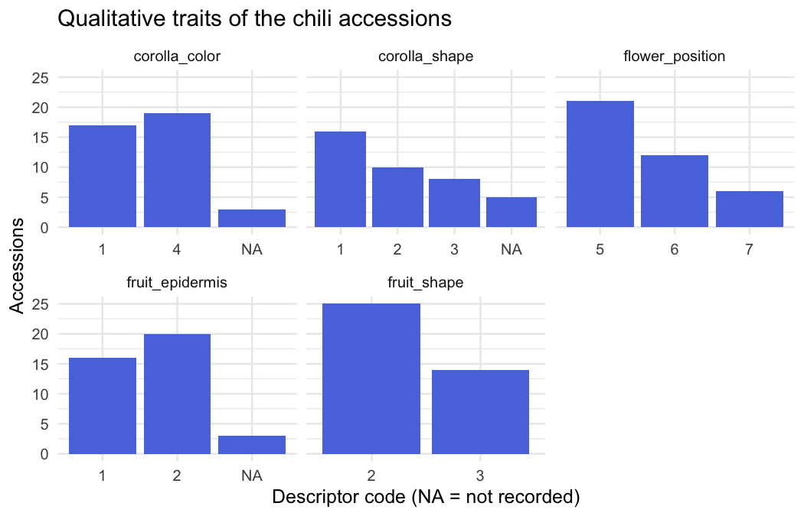
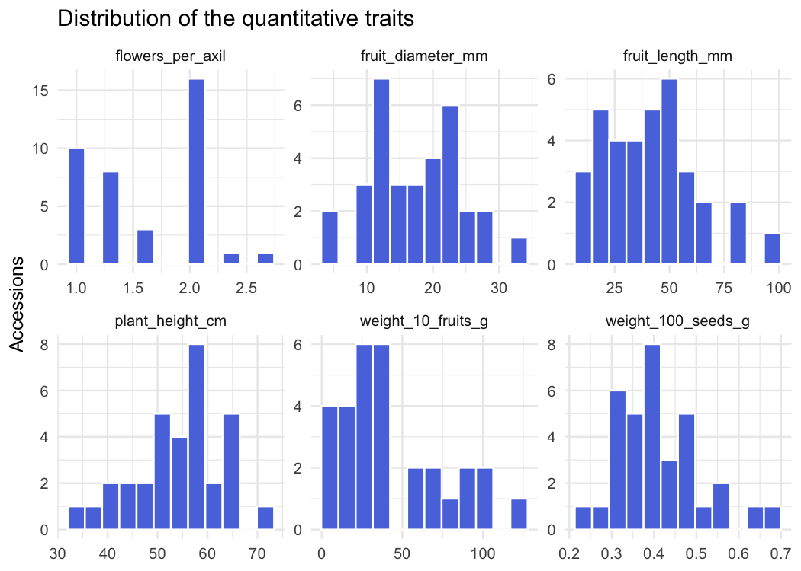
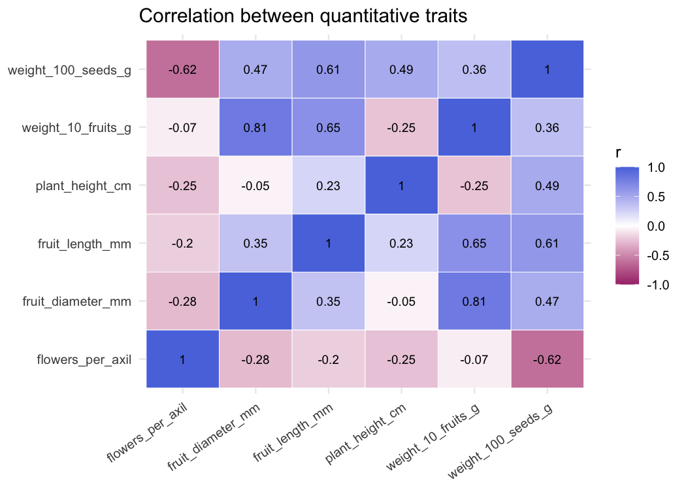
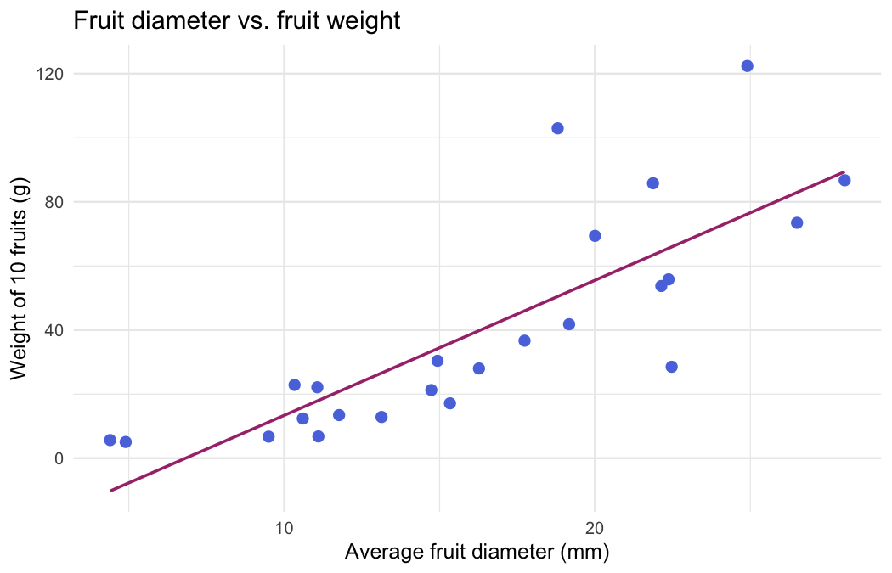
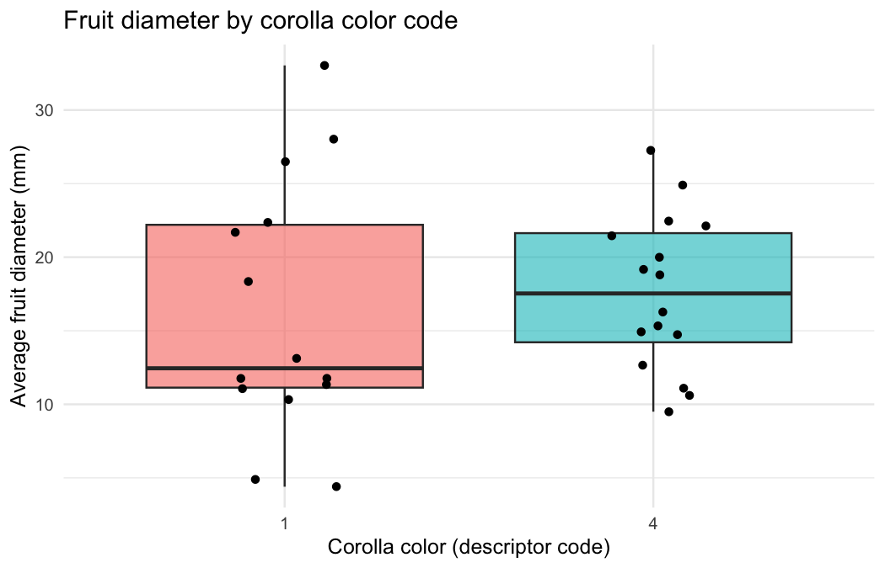
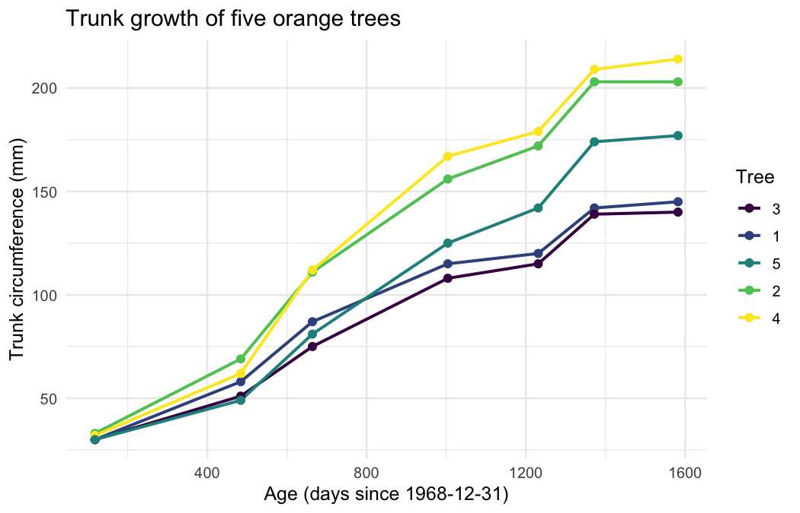
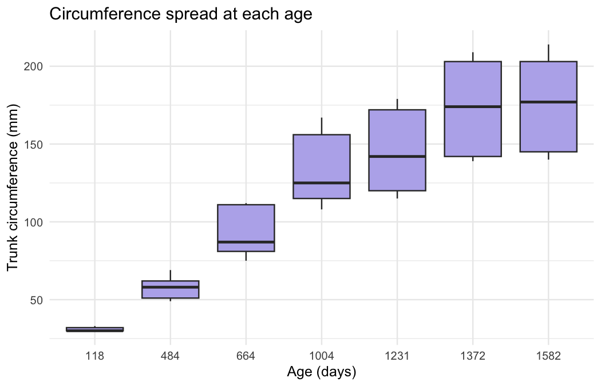

01 · R Basics and Exploratory Data Analysis
================
María José Ospina Samboni

This report covers the first steps of any analysis in R: working with
the basic data structures, loading a real dataset, handling
missing-value codes and describing the data with tables, summary
statistics and plots. It closes with a short exploratory analysis of the
`Orange` tree-growth dataset.

``` r
library(tidyverse)
library(modeest)   # most frequent value (mode)
library(knitr)     # tables

theme_set(theme_minimal(base_size = 12))
```

## 1. R essentials

### Vectors, factors and data frames

``` r
# Numeric and character vectors
x <- c(1, 2, 3, 4, 5)
x_chr <- as.character(x)
class(x); class(x_chr)
```

    ## [1] "numeric"

    ## [1] "character"

``` r
# A vector holds a single type: mixing numbers and text turns everything into text
mixed <- c(1, 2, 3, "2", "3")
class(mixed)
```

    ## [1] "character"

``` r
# Indexing
x <- 1:8
x[3]          # third element
```

    ## [1] 3

``` r
x[-4]         # all but the fourth
```

    ## [1] 1 2 3 5 6 7 8

``` r
x[x > 3]      # elements greater than 3
```

    ## [1] 4 5 6 7 8

``` r
# Factors: categorical variables with levels
f <- factor(c("A", "B", "A", "C", "A", "C"))
levels(f)
```

    ## [1] "A" "B" "C"

``` r
table(f)
```

    ## f
    ## A B C 
    ## 3 1 2

``` r
# Data frames: one column per variable, one row per observation
df <- data.frame(value = c(1, 2, 3, 4, 5),
                 group = factor(c("A", "B", "A", "A", "C")))
str(df)
```

    ## 'data.frame':    5 obs. of  2 variables:
    ##  $ value: num  1 2 3 4 5
    ##  $ group: Factor w/ 3 levels "A","B","C": 1 2 1 1 3

### Matrices

``` r
m1 <- matrix(1:9, nrow = 3)
m2 <- m1 * 15

m1 + m2       # element-wise sum
```

    ##      [,1] [,2] [,3]
    ## [1,]   16   64  112
    ## [2,]   32   80  128
    ## [3,]   48   96  144

``` r
m1 %*% m2     # matrix product
```

    ##      [,1] [,2] [,3]
    ## [1,]  450  990 1530
    ## [2,]  540 1215 1890
    ## [3,]  630 1440 2250

``` r
t(m1)         # transpose
```

    ##      [,1] [,2] [,3]
    ## [1,]    1    2    3
    ## [2,]    4    5    6
    ## [3,]    7    8    9

### Measures of central tendency and outliers

The mean is sensitive to extreme values; the median and the mode are
not.

``` r
a <- c(5, 6, 6, 7, 7, 7, 8, 8, 9, 10)
b <- c(5, 6, 6, 7, 7, 7, 8, 8, 9, 20)   # same data, one extreme value

tibble(
  dataset = c("Without outlier", "With outlier (20)"),
  mean    = c(mean(a), mean(b)),
  median  = c(median(a), median(b)),
  mode    = c(mfv(a), mfv(b))
) |> kable()
```

| dataset           | mean | median | mode |
|:------------------|-----:|-------:|-----:|
| Without outlier   |  7.3 |      7 |    7 |
| With outlier (20) |  8.3 |      7 |    7 |

Changing a single value from 10 to 20 moves the mean from 7.3 to 8.3,
while the median and the mode stay the same.

## 2. Chili pepper accessions

The dataset describes **39 chili pepper (*Capsicum*) accessions** from a
germplasm collection, with six quantitative traits measured on the
plants and fruits, and five qualitative traits recorded as numeric
codes.

### Load and rename

``` r
chili_raw <- read_csv("data/chili_accessions.csv")

chili <- chili_raw |>
  rename(
    accession            = n_acces,
    fruit_diameter_mm    = diametro_de_fruto_promedio_mm,
    weight_100_seeds_g   = peso_100_semillas,
    flowers_per_axil     = n_flores_axila,
    weight_10_fruits_g   = peso_10_frutos_gr,
    plant_height_cm      = altura_promedio_planta,
    fruit_length_mm      = longitud_fruto_promedio_mm,
    corolla_color        = color_de_corola,
    fruit_epidermis      = tipo_epidermis_fruto,
    fruit_shape          = forma_fruto,
    flower_position      = posicion_de_la_flor,
    corolla_shape        = forma_de_corola_flor
  )

glimpse(chili)
```

    ## Rows: 39
    ## Columns: 12
    ## $ accession          <dbl> 10, 11, 18, 41, 43, 50, 51, 54, 67, 68, 85, 147, 14…
    ## $ fruit_diameter_mm  <dbl> 20.00000, 9.50000, 24.90000, 16.26667, 999.00000, 9…
    ## $ weight_100_seeds_g <dbl> 0.3460000, 0.2333333, 0.4093333, 0.4100000, 0.40733…
    ## $ flowers_per_axil   <dbl> 1.000000, 2.000000, 1.333333, 1.666667, 2.000000, 2…
    ## $ weight_10_fruits_g <dbl> 69.400000, 6.733333, 122.400000, 28.000000, 35.5333…
    ## $ plant_height_cm    <dbl> 40.76667, 33.73333, 38.30000, 43.83333, 42.70000, 5…
    ## $ fruit_length_mm    <dbl> 37.33333, 10.73333, 51.03333, 47.13333, 55.30000, 5…
    ## $ corolla_color      <dbl> 4, 4, 4, 4, 4, 4, 9, 4, 4, 4, 4, 1, 1, 1, 1, 1, 9, …
    ## $ fruit_epidermis    <dbl> 2, 2, 2, 2, 2, 2, 2, 2, 2, 9, 2, 2, 2, 2, 9, 2, 2, …
    ## $ fruit_shape        <dbl> 2, 2, 2, 2, 2, 2, 2, 2, 2, 2, 2, 2, 2, 2, 2, 2, 2, …
    ## $ flower_position    <dbl> 5, 5, 5, 5, 5, 5, 5, 5, 5, 5, 5, 5, 5, 5, 5, 5, 5, …
    ## $ corolla_shape      <dbl> 9, 1, 1, 9, 1, 1, 1, 9, 1, 1, 1, 1, 1, 9, 1, 1, 1, …

### Missing-value codes

The dataset does not use empty cells for missing data. It uses codes
instead: **`999`** in the quantitative traits and **`9`** in the
qualitative ones. If they are not replaced, R treats them as real values
and every mean and plot is wrong.

``` r
quantitative <- c("fruit_diameter_mm", "weight_100_seeds_g", "flowers_per_axil",
                  "weight_10_fruits_g", "plant_height_cm", "fruit_length_mm")
qualitative  <- c("corolla_color", "fruit_epidermis", "fruit_shape",
                  "flower_position", "corolla_shape")

# Maximum value of each quantitative trait before cleaning
chili |> summarise(across(all_of(quantitative), max)) |> kable()
```

| fruit_diameter_mm | weight_100_seeds_g | flowers_per_axil | weight_10_fruits_g | plant_height_cm | fruit_length_mm |
|---:|---:|---:|---:|---:|---:|
| 999 | 999 | 2.666667 | 999 | 999 | 999 |

``` r
chili <- chili |>
  mutate(
    across(all_of(quantitative), ~ na_if(.x, 999)),
    across(all_of(qualitative),  ~ factor(na_if(.x, 9)))
  )

# Missing values per variable after recoding
chili |>
  summarise(across(everything(), ~ sum(is.na(.x)))) |>
  pivot_longer(everything(), names_to = "variable", values_to = "missing") |>
  filter(missing > 0) |>
  arrange(desc(missing)) |>
  kable()
```

| variable           | missing |
|:-------------------|--------:|
| weight_10_fruits_g |       9 |
| fruit_diameter_mm  |       6 |
| plant_height_cm    |       6 |
| weight_100_seeds_g |       5 |
| corolla_shape      |       5 |
| fruit_length_mm    |       4 |
| corolla_color      |       3 |
| fruit_epidermis    |       3 |

``` r
complete <- sum(complete.cases(chili))
```

Only **10 of 39 accessions** have every trait recorded, so each analysis
below uses the values available for the variables involved instead of
dropping whole accessions.

### Qualitative traits

``` r
table(chili$corolla_color, useNA = "ifany")
```

    ## 
    ##    1    4 <NA> 
    ##   17   19    3

``` r
# Two traits together: absolute and row-relative frequencies
tab <- table(corolla_color = chili$corolla_color,
             flower_position = chili$flower_position)
tab
```

    ##              flower_position
    ## corolla_color  5  6  7
    ##             1  9  8  0
    ##             4 10  3  6

``` r
round(prop.table(tab, margin = 1), 2)
```

    ##              flower_position
    ## corolla_color    5    6    7
    ##             1 0.53 0.47 0.00
    ##             4 0.53 0.16 0.32

``` r
chili |>
  pivot_longer(all_of(qualitative), names_to = "trait", values_to = "code") |>
  ggplot(aes(x = code)) +
  geom_bar(fill = "#5a78e0") +
  facet_wrap(~ trait, scales = "free_x") +
  labs(title = "Qualitative traits of the chili accessions",
       x = "Descriptor code (NA = not recorded)", y = "Accessions")
```

<!-- -->

### Quantitative traits

``` r
chili |>
  pivot_longer(all_of(quantitative), names_to = "trait", values_to = "value") |>
  group_by(trait) |>
  summarise(
    n      = sum(!is.na(value)),
    mean   = mean(value, na.rm = TRUE),
    median = median(value, na.rm = TRUE),
    sd     = sd(value, na.rm = TRUE),
    min    = min(value, na.rm = TRUE),
    max    = max(value, na.rm = TRUE)
  ) |>
  mutate(across(mean:max, ~ round(.x, 2))) |>
  kable()
```

| trait              |   n |  mean | median |    sd |   min |    max |
|:-------------------|----:|------:|-------:|------:|------:|-------:|
| flowers_per_axil   |  39 |  1.61 |   1.67 |  0.47 |  1.00 |   2.67 |
| fruit_diameter_mm  |  33 | 17.26 |  17.73 |  6.76 |  4.40 |  33.03 |
| fruit_length_mm    |  35 | 41.30 |  42.20 | 20.95 | 10.73 |  97.07 |
| plant_height_cm    |  33 | 54.24 |  55.60 |  8.91 | 33.73 |  71.60 |
| weight_100_seeds_g |  34 |  0.41 |   0.40 |  0.10 |  0.23 |   0.68 |
| weight_10_fruits_g |  30 | 42.97 |  33.10 | 33.03 |  5.07 | 122.40 |

``` r
chili |>
  pivot_longer(all_of(quantitative), names_to = "trait", values_to = "value") |>
  filter(!is.na(value)) |>
  ggplot(aes(x = value)) +
  geom_histogram(bins = 12, fill = "#5a78e0", color = "white") +
  facet_wrap(~ trait, scales = "free") +
  labs(title = "Distribution of the quantitative traits", x = NULL, y = "Accessions")
```

<!-- -->

### Relationships between traits

``` r
cor_matrix <- chili |>
  select(all_of(quantitative)) |>
  cor(use = "pairwise.complete.obs")

round(cor_matrix, 2)
```

    ##                    fruit_diameter_mm weight_100_seeds_g flowers_per_axil
    ## fruit_diameter_mm               1.00               0.47            -0.28
    ## weight_100_seeds_g              0.47               1.00            -0.62
    ## flowers_per_axil               -0.28              -0.62             1.00
    ## weight_10_fruits_g              0.81               0.36            -0.07
    ## plant_height_cm                -0.05               0.49            -0.25
    ## fruit_length_mm                 0.35               0.61            -0.20
    ##                    weight_10_fruits_g plant_height_cm fruit_length_mm
    ## fruit_diameter_mm                0.81           -0.05            0.35
    ## weight_100_seeds_g               0.36            0.49            0.61
    ## flowers_per_axil                -0.07           -0.25           -0.20
    ## weight_10_fruits_g               1.00           -0.25            0.65
    ## plant_height_cm                 -0.25            1.00            0.23
    ## fruit_length_mm                  0.65            0.23            1.00

``` r
cor_matrix |>
  as_tibble(rownames = "trait_1") |>
  pivot_longer(-trait_1, names_to = "trait_2", values_to = "r") |>
  ggplot(aes(trait_1, trait_2, fill = r)) +
  geom_tile(color = "white") +
  geom_text(aes(label = round(r, 2)), size = 3.2) +
  scale_fill_gradient2(low = "#a8367a", mid = "white", high = "#5a78e0", limits = c(-1, 1)) +
  labs(title = "Correlation between quantitative traits", x = NULL, y = NULL) +
  theme(axis.text.x = element_text(angle = 35, hjust = 1))
```

<!-- -->

``` r
strongest <- cor_matrix |>
  as_tibble(rownames = "trait_1") |>
  pivot_longer(-trait_1, names_to = "trait_2", values_to = "r") |>
  filter(trait_1 < trait_2) |>
  slice_max(abs(r), n = 1, with_ties = FALSE)
```

The strongest relationship is between **fruit_diameter_mm** and
**weight_10_fruits_g** (r = 0.81).

``` r
chili |>
  filter(!is.na(fruit_diameter_mm), !is.na(weight_10_fruits_g)) |>
  ggplot(aes(fruit_diameter_mm, weight_10_fruits_g)) +
  geom_point(size = 2.5, color = "#5a78e0") +
  geom_smooth(method = "lm", se = FALSE, color = "#a8367a", linewidth = 0.8) +
  labs(title = "Fruit diameter vs. fruit weight",
       x = "Average fruit diameter (mm)", y = "Weight of 10 fruits (g)")
```

<!-- -->

``` r
chili |>
  filter(!is.na(corolla_color), !is.na(fruit_diameter_mm)) |>
  ggplot(aes(corolla_color, fruit_diameter_mm, fill = corolla_color)) +
  geom_boxplot(show.legend = FALSE, alpha = 0.6) +
  geom_jitter(width = 0.15, show.legend = FALSE) +
  labs(title = "Fruit diameter by corolla color code",
       x = "Corolla color (descriptor code)", y = "Average fruit diameter (mm)")
```

<!-- -->

## 3. Exercise: `Orange` tree growth

The built-in `Orange` dataset records the **trunk circumference** of 5
orange trees measured at 7 ages.

``` r
data("Orange")
glimpse(Orange)
```

    ## Rows: 35
    ## Columns: 3
    ## $ Tree          <ord> 1, 1, 1, 1, 1, 1, 1, 2, 2, 2, 2, 2, 2, 2, 3, 3, 3, 3, 3,…
    ## $ age           <dbl> 118, 484, 664, 1004, 1231, 1372, 1582, 118, 484, 664, 10…
    ## $ circumference <dbl> 30, 58, 87, 115, 120, 142, 145, 33, 69, 111, 156, 172, 2…

``` r
summary(Orange)
```

    ##  Tree       age         circumference  
    ##  3:7   Min.   : 118.0   Min.   : 30.0  
    ##  1:7   1st Qu.: 484.0   1st Qu.: 65.5  
    ##  5:7   Median :1004.0   Median :115.0  
    ##  2:7   Mean   : 922.1   Mean   :115.9  
    ##  4:7   3rd Qu.:1372.0   3rd Qu.:161.5  
    ##        Max.   :1582.0   Max.   :214.0

``` r
Orange |>
  ggplot(aes(age, circumference, color = Tree, group = Tree)) +
  geom_line(linewidth = 0.9) +
  geom_point(size = 2) +
  labs(title = "Trunk growth of five orange trees",
       x = "Age (days since 1968-12-31)", y = "Trunk circumference (mm)", color = "Tree")
```

<!-- -->

``` r
Orange |>
  group_by(Tree) |>
  summarise(
    final_circumference = max(circumference),
    growth_mm_per_year  = round((max(circumference) - min(circumference)) /
                                (max(age) - min(age)) * 365, 1)
  ) |>
  arrange(desc(final_circumference)) |>
  kable()
```

| Tree | final_circumference | growth_mm_per_year |
|:-----|--------------------:|-------------------:|
| 4    |                 214 |               45.4 |
| 2    |                 203 |               42.4 |
| 5    |                 177 |               36.6 |
| 1    |                 145 |               28.7 |
| 3    |                 140 |               27.4 |

``` r
r_orange <- cor(Orange$age, Orange$circumference)
```

``` r
Orange |>
  ggplot(aes(factor(age), circumference)) +
  geom_boxplot(fill = "#b9b2ec") +
  labs(title = "Circumference spread at each age",
       x = "Age (days)", y = "Trunk circumference (mm)")
```

<!-- -->

## Key takeaways

- Missing-value codes such as `999` and `9` must be replaced with `NA`
  before any calculation; otherwise a single code can distort means,
  correlations and plots.
- In the chili collection, only 10 of 39 accessions are complete, so
  analyses use the data available for each variable.
- In the `Orange` data, age and trunk circumference are strongly
  correlated (r = 0.91), but the trees grow at different rates, and the
  differences between them widen with age.
