02 · Data Visualization with ggplot2
================
Maria Jose Ospina

This report builds plots step by step with **ggplot2**, from a basic
scatter plot to a full visual story. It uses four classic datasets to
compare groups, follow trends over time and show distributions, and ends
with a case study on **who survived the Titanic**.

``` r
library(tidyverse)
library(agricolae)   # frijol dataset
library(knitr)

theme_set(theme_minimal(base_size = 12))

# Colorblind-safe palette (Okabe-Ito)
pal3 <- c("#0072B2", "#D55E00", "#009E73")
pal4 <- c("#0072B2", "#D55E00", "#009E73", "#CC79A7")
```

## 1. The grammar of graphics

Every ggplot is built from the same parts:

| Part | What it does | Example |
|----|----|----|
| **Data** | The data frame to plot | `ggplot(iris)` |
| **Aesthetics** | Which variables go to x, y, color, size, shape… | `aes(x = Petal.Length, y = Sepal.Width)` |
| **Geometries** | How the data is drawn | `geom_point()`, `geom_boxplot()` |
| **Scales, facets, themes** | Colors, panels and overall look | `scale_color_manual()`, `facet_wrap()`, `theme_minimal()` |

### From a plain scatter plot to a multi-variable one

``` r
ggplot(iris, aes(x = Petal.Length, y = Sepal.Width)) +
  geom_point() +
  labs(title = "A plain scatter plot")
```

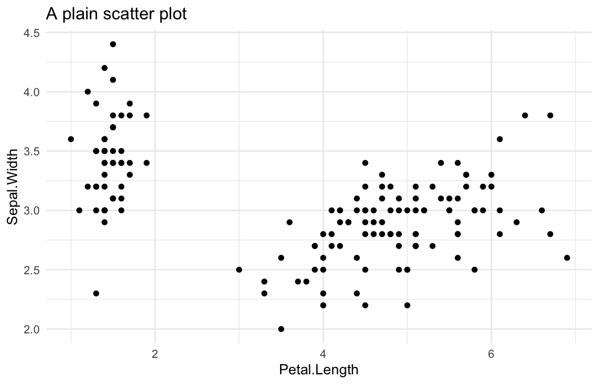<!-- -->

Adding color reveals that the cloud of points is really three species:

``` r
ggplot(iris, aes(Petal.Length, Sepal.Width, color = Species)) +
  geom_point(size = 2) +
  scale_color_manual(values = pal3) +
  labs(title = "Iris species form separate groups",
       x = "Petal length (cm)", y = "Sepal width (cm)")
```

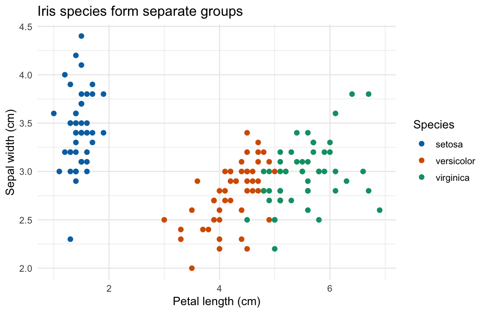<!-- -->

More aesthetics can encode more variables at once. Here shape repeats
the species (so the plot also works without color) and size shows petal
width:

``` r
ggplot(iris, aes(Petal.Length, Sepal.Width,
                 color = Species, shape = Species, size = Petal.Width)) +
  geom_jitter(width = 0.05, height = 0.05, alpha = 0.7) +
  scale_color_manual(values = pal3) +
  labs(title = "Four variables in one plot",
       x = "Petal length (cm)", y = "Sepal width (cm)", size = "Petal width (cm)")
```

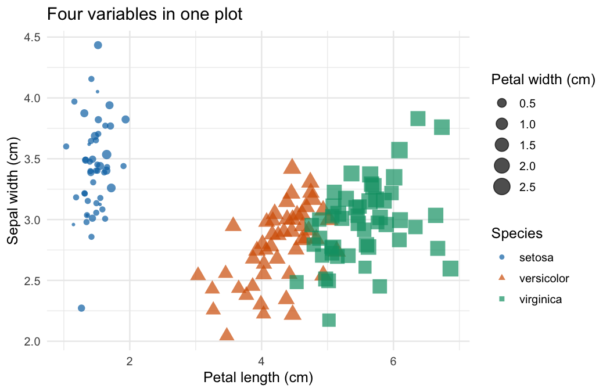<!-- -->

Class exercise: the same plot with sepal length vs. petal width, sized
by sepal width.

``` r
ggplot(iris, aes(Sepal.Length, Petal.Width,
                 color = Species, shape = Species, size = Sepal.Width)) +
  geom_jitter(width = 0.05, height = 0.05, alpha = 0.7) +
  scale_color_manual(values = pal3) +
  labs(title = "Sepal length vs. petal width",
       x = "Sepal length (cm)", y = "Petal width (cm)", size = "Sepal width (cm)")
```

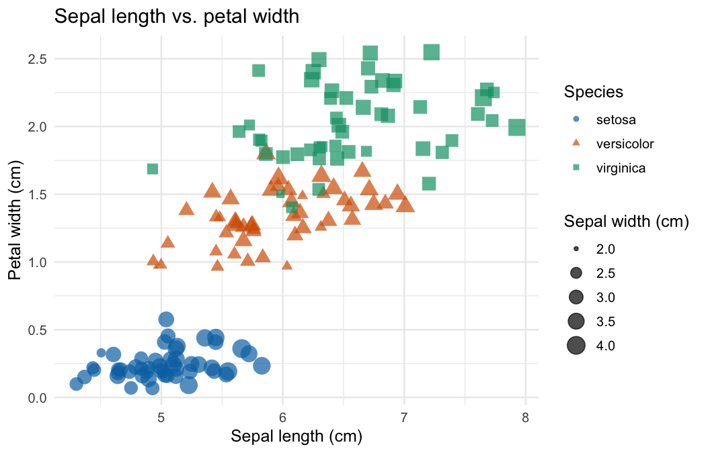<!-- -->

## 2. Comparing groups

A bar of means hides how the data is spread; adding the points and an
error bar shows it.

``` r
ggplot(iris, aes(Species, Sepal.Length, fill = Species)) +
  stat_summary(fun = mean, geom = "bar", alpha = 0.6, show.legend = FALSE) +
  stat_summary(fun.data = mean_se, geom = "errorbar", width = 0.2) +
  geom_jitter(width = 0.15, size = 1, alpha = 0.6, show.legend = FALSE) +
  scale_fill_manual(values = pal3) +
  labs(title = "Mean sepal length by species (± standard error)",
       x = NULL, y = "Sepal length (cm)")
```

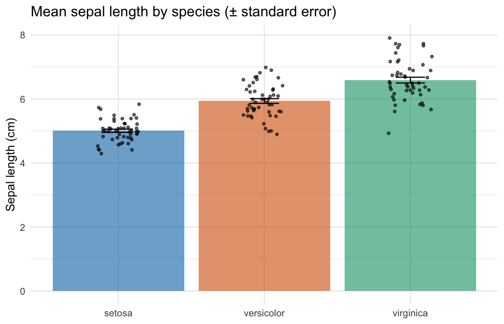<!-- -->

Boxplots summarize the median and quartiles. The **notches** give a
rough 95% interval for the median: when two notches do not overlap, the
medians are likely different.

``` r
ggplot(iris, aes(Species, Sepal.Length, fill = Species)) +
  geom_boxplot(notch = TRUE, alpha = 0.6, show.legend = FALSE) +
  geom_jitter(width = 0.15, size = 1, alpha = 0.5, show.legend = FALSE) +
  scale_fill_manual(values = pal3) +
  labs(title = "Sepal length by species", x = NULL, y = "Sepal length (cm)")
```

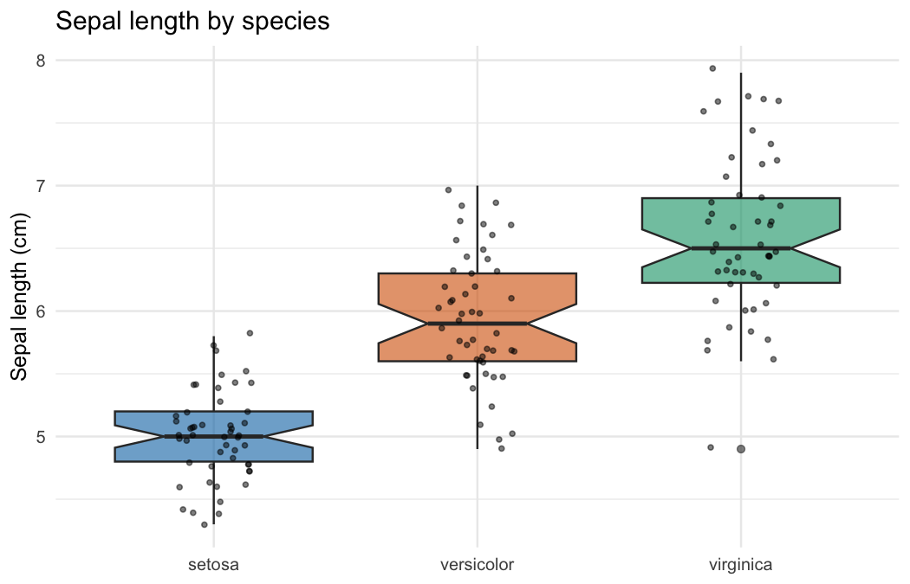<!-- -->

Violin plots add the shape of the distribution:

``` r
ggplot(iris, aes(Species, Sepal.Length, fill = Species)) +
  geom_violin(alpha = 0.5, show.legend = FALSE) +
  geom_boxplot(width = 0.15, show.legend = FALSE) +
  scale_fill_manual(values = pal3) +
  coord_flip() +
  labs(title = "Distribution of sepal length", x = NULL, y = "Sepal length (cm)")
```

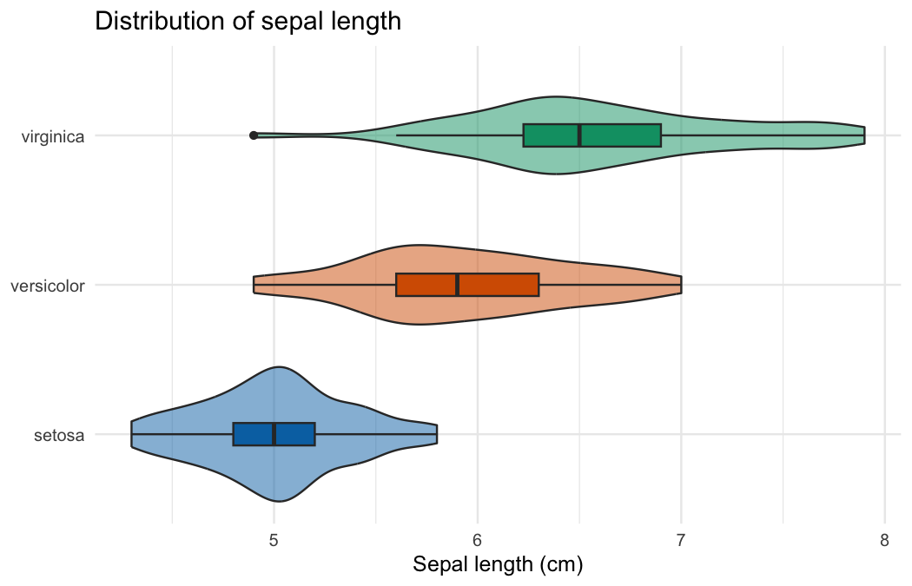<!-- -->

### Themes

The same plot with three built-in themes:

``` r
base_plot <- ggplot(iris, aes(Petal.Length, Sepal.Width, color = Species)) +
  geom_point(show.legend = FALSE) +
  scale_color_manual(values = pal3)

themes <- list(theme_minimal(), theme_bw(), theme_classic())
names(themes) <- c("theme_minimal()", "theme_bw()", "theme_classic()")

# Facets cannot change themes, so each version is drawn separately
for (t in names(themes)) print(base_plot + themes[[t]] + labs(title = t))
```

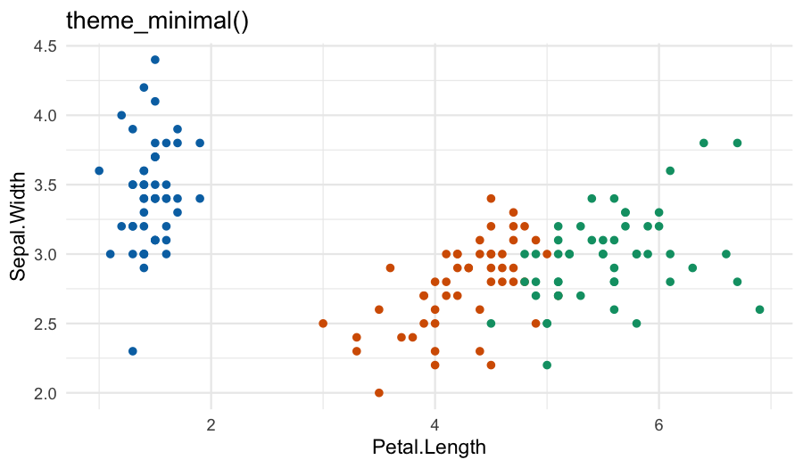<!-- -->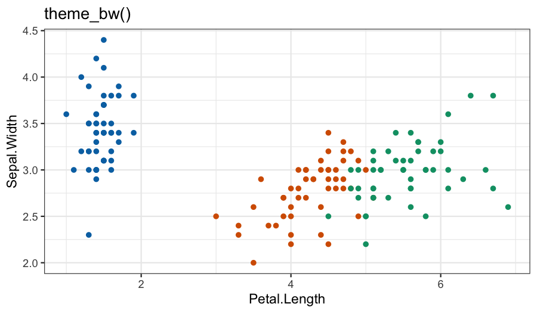<!-- -->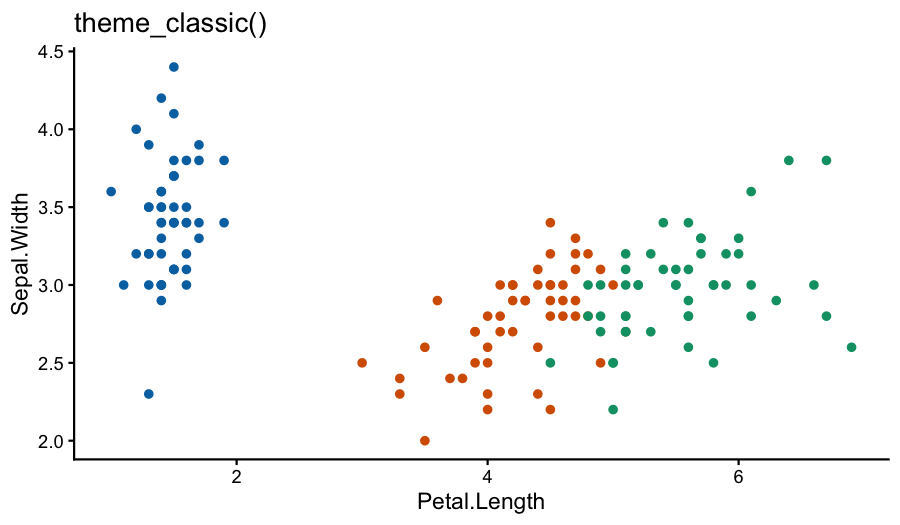<!-- -->

## 3. A factorial experiment: `ToothGrowth`

Tooth length in 60 guinea pigs given vitamin C at three doses, through
two delivery methods: orange juice (`OJ`) or ascorbic acid (`VC`).

``` r
ToothGrowth |>
  mutate(dose = factor(dose)) |>
  ggplot(aes(dose, len, color = supp, group = supp)) +
  stat_summary(fun = mean, geom = "line", linewidth = 1) +
  stat_summary(fun.data = mean_se, geom = "pointrange") +
  scale_color_manual(values = pal3[1:2], labels = c(OJ = "Orange juice", VC = "Ascorbic acid")) +
  labs(title = "Higher doses of vitamin C, longer teeth",
       subtitle = "Mean ± standard error, 10 animals per group",
       x = "Dose (mg/day)", y = "Tooth length", color = "Delivery")
```

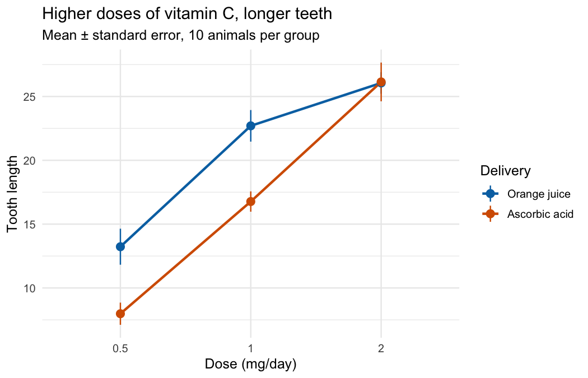<!-- -->

``` r
gap <- ToothGrowth |>
  group_by(dose, supp) |>
  summarise(mean_len = mean(len), .groups = "drop") |>
  pivot_wider(names_from = supp, values_from = mean_len) |>
  mutate(difference = round(OJ - VC, 2))

kable(gap, digits = 2)
```

| dose |    OJ |    VC | difference |
|-----:|------:|------:|-----------:|
|  0.5 | 13.23 |  7.98 |       5.25 |
|  1.0 | 22.70 | 16.77 |       5.93 |
|  2.0 | 26.06 | 26.14 |      -0.08 |

Orange juice works better at low doses, but at 2 mg/day the two methods
give almost the same result (difference of -0.08).

## 4. Trends over time: `ChickWeight`

Weight of 50 chicks on four different diets, measured from birth to day
21.

``` r
ChickWeight |>
  group_by(Time, Diet) |>
  summarise(mean_weight = mean(weight), .groups = "drop") |>
  ggplot(aes(Time, mean_weight, color = Diet)) +
  geom_line(linewidth = 1) +
  geom_point(size = 1.8) +
  scale_color_manual(values = pal4) +
  labs(title = "Average chick weight by diet",
       x = "Days since birth", y = "Mean weight (g)", color = "Diet")
```

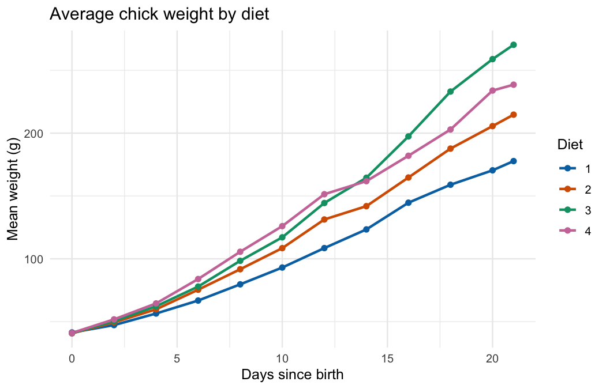<!-- -->

``` r
final <- ChickWeight |>
  filter(Time == 21) |>
  group_by(Diet) |>
  summarise(chicks = n(), mean_weight_day21 = round(mean(weight), 1)) |>
  arrange(desc(mean_weight_day21))

kable(final)
```

| Diet | chicks | mean_weight_day21 |
|:-----|-------:|------------------:|
| 3    |     10 |             270.3 |
| 4    |      9 |             238.6 |
| 2    |     10 |             214.7 |
| 1    |     16 |             177.8 |

## 5. Distributions: bean production (`agricolae::frijol`)

``` r
data("frijol")
glimpse(frijol)
```

    ## Rows: 84
    ## Columns: 3
    ## $ technology <fct> a, a, a, a, a, a, a, a, a, a, a, a, a, a, a, a, a, a, a, a,…
    ## $ production <int> 1036, 364, 1019, 447, 1532, 1161, 1309, 834, 729, 749, 918,…
    ## $ index      <dbl> 975.25, 310.25, 1041.00, 568.75, 1380.50, 1367.75, 1517.25,…

``` r
ggplot(frijol, aes(production)) +
  geom_histogram(bins = 15, fill = "#0072B2", color = "white") +
  labs(title = "Distribution of bean production", x = "Production", y = "Count")
```

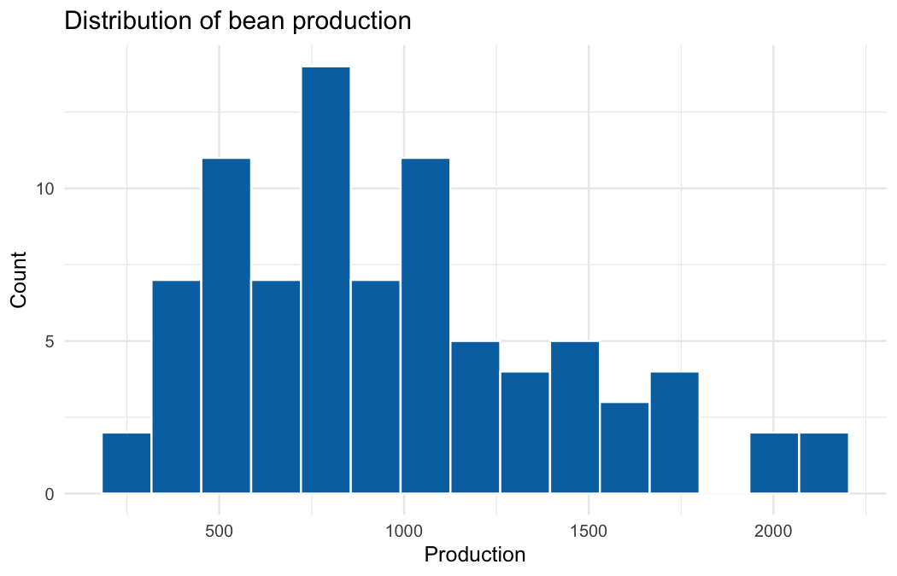<!-- -->

``` r
ggplot(frijol, aes(technology, production)) +
  geom_boxplot(fill = "#0072B2", alpha = 0.35) +
  geom_jitter(width = 0.15, size = 1, alpha = 0.5) +
  labs(title = "Bean production by technology", x = "Technology", y = "Production")
```

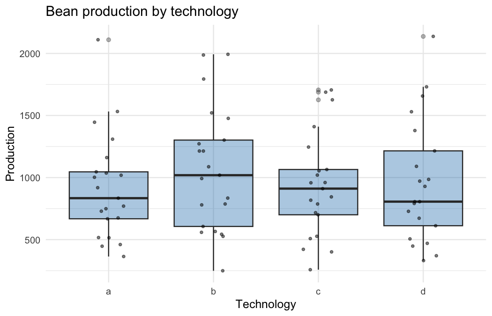<!-- -->

## 6. Case study: who survived the Titanic?

The dataset contains 891 passengers from the Titanic’s maiden voyage,
with their class, sex, age and whether they survived.

``` r
titanic_file <- "data/titanic.csv"

# Download once and keep a local copy, so the report does not depend on the link
if (!file.exists(titanic_file)) {
  dir.create("data", showWarnings = FALSE)
  download.file(
    "https://raw.githubusercontent.com/datasciencedojo/datasets/master/titanic.csv",
    titanic_file
  )
}

titanic <- read_csv(titanic_file) |>
  select(-Ticket, -Cabin) |>
  mutate(
    Survived = factor(if_else(Survived == 1, "Survived", "Died"), levels = c("Died", "Survived")),
    Pclass   = factor(Pclass, labels = c("1st class", "2nd class", "3rd class")),
    Sex      = factor(Sex, levels = c("female", "male"), labels = c("Women", "Men")),
    Embarked = factor(Embarked)
  )

glimpse(titanic)
```

    ## Rows: 891
    ## Columns: 10
    ## $ PassengerId <dbl> 1, 2, 3, 4, 5, 6, 7, 8, 9, 10, 11, 12, 13, 14, 15, 16, 17,…
    ## $ Survived    <fct> Died, Survived, Survived, Survived, Died, Died, Died, Died…
    ## $ Pclass      <fct> 3rd class, 1st class, 3rd class, 1st class, 3rd class, 3rd…
    ## $ Name        <chr> "Braund, Mr. Owen Harris", "Cumings, Mrs. John Bradley (Fl…
    ## $ Sex         <fct> Men, Women, Women, Women, Men, Men, Men, Men, Women, Women…
    ## $ Age         <dbl> 22, 38, 26, 35, 35, NA, 54, 2, 27, 14, 4, 58, 20, 39, 14, …
    ## $ SibSp       <dbl> 1, 1, 0, 1, 0, 0, 0, 3, 0, 1, 1, 0, 0, 1, 0, 0, 4, 0, 1, 0…
    ## $ Parch       <dbl> 0, 0, 0, 0, 0, 0, 0, 1, 2, 0, 1, 0, 0, 5, 0, 0, 1, 0, 0, 0…
    ## $ Fare        <dbl> 7.2500, 71.2833, 7.9250, 53.1000, 8.0500, 8.4583, 51.8625,…
    ## $ Embarked    <fct> S, C, S, S, S, Q, S, S, S, C, S, S, S, S, S, S, Q, S, S, C…

``` r
surv_colors <- c(Died = "#B4B4BE", Survived = "#0072B2")
```

### Most passengers did not survive

``` r
overall <- mean(titanic$Survived == "Survived")

ggplot(titanic, aes(Survived, fill = Survived)) +
  geom_bar(show.legend = FALSE) +
  scale_fill_manual(values = surv_colors) +
  labs(title = paste0("Only ", round(overall * 100), "% of passengers survived"),
       x = NULL, y = "Passengers")
```

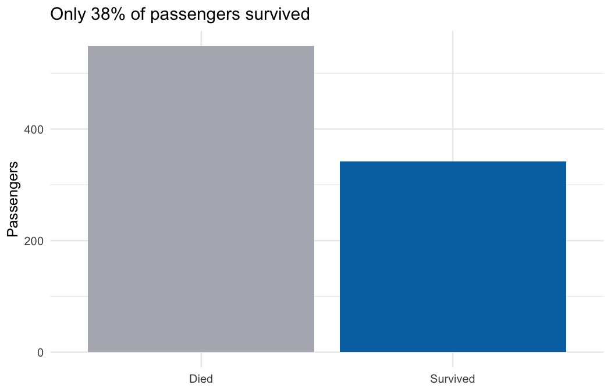<!-- -->

### Sex made the biggest difference

``` r
by_sex <- titanic |>
  group_by(Sex) |>
  summarise(rate = mean(Survived == "Survived"))

ggplot(titanic, aes(Sex, fill = Survived)) +
  geom_bar(position = "fill") +
  scale_fill_manual(values = surv_colors) +
  scale_y_continuous(labels = scales::percent) +
  labs(title = "Survival rate by sex", x = NULL, y = "Share of passengers", fill = NULL)
```

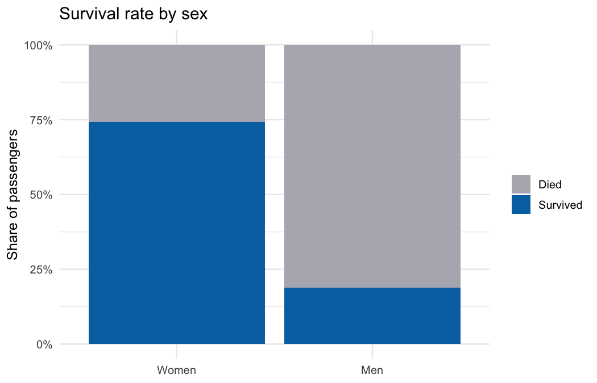<!-- -->

74% of women survived, compared with 19% of men: the “women and children
first” rule shows clearly in the data.

### And so did class

``` r
ggplot(titanic, aes(Pclass, fill = Survived)) +
  geom_bar(position = "fill") +
  scale_fill_manual(values = surv_colors) +
  scale_y_continuous(labels = scales::percent) +
  labs(title = "Survival rate by class", x = NULL, y = "Share of passengers", fill = NULL)
```

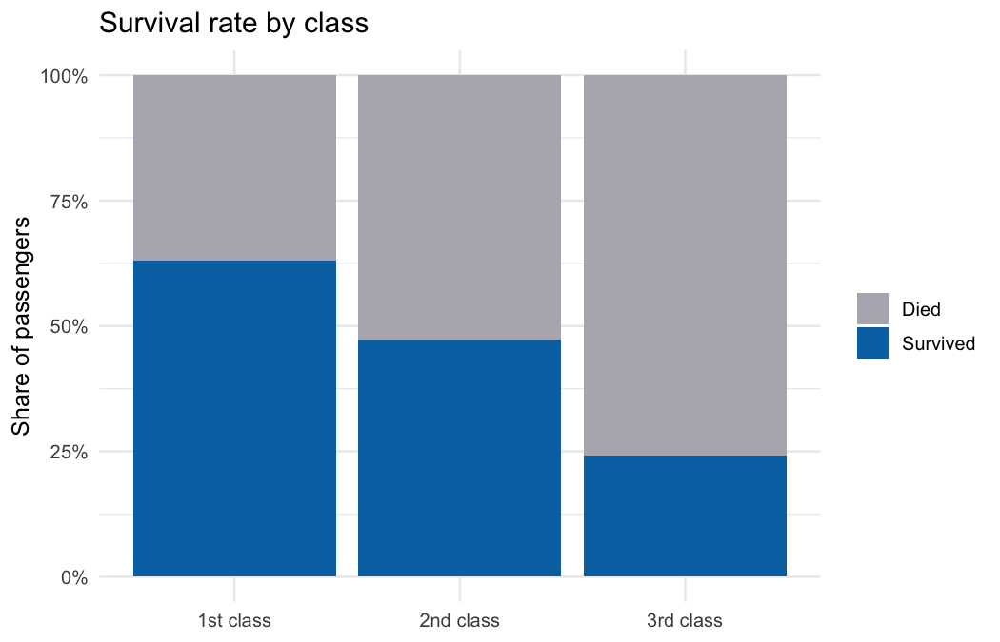<!-- -->

### Sex and class together

``` r
sex_class <- titanic |>
  group_by(Pclass, Sex) |>
  summarise(passengers = n(), rate = mean(Survived == "Survived"), .groups = "drop")

ggplot(sex_class, aes(Pclass, rate, fill = Sex)) +
  geom_col(position = position_dodge(width = 0.8), width = 0.7) +
  geom_text(aes(label = scales::percent(rate, accuracy = 1)),
            position = position_dodge(width = 0.8), vjust = -0.4, size = 3.5) +
  scale_fill_manual(values = c(Women = "#D55E00", Men = "#0072B2")) +
  scale_y_continuous(labels = scales::percent, limits = c(0, 1.05)) +
  labs(title = "Survival rate by class and sex", x = NULL, y = "Survival rate", fill = NULL)
```

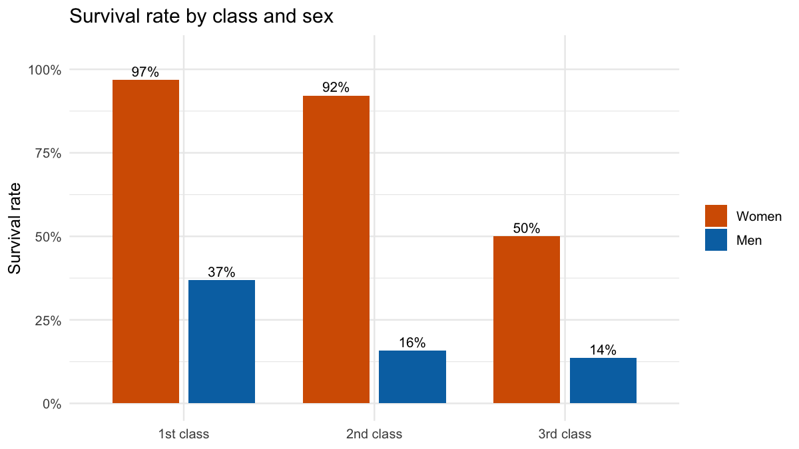<!-- -->

``` r
best  <- sex_class |> slice_max(rate, n = 1, with_ties = FALSE)
worst <- sex_class |> slice_min(rate, n = 1, with_ties = FALSE)
```

The gap is striking: **women in 1st class** had a survival rate of 97%,
while **men in 3rd class** had only 14%.

### Age by class

``` r
titanic |>
  filter(!is.na(Age)) |>
  ggplot(aes(Pclass, Age, fill = Pclass)) +
  geom_boxplot(alpha = 0.6, show.legend = FALSE, outlier.shape = NA) +
  geom_jitter(width = 0.2, size = 0.7, alpha = 0.4, show.legend = FALSE) +
  scale_fill_manual(values = pal3) +
  labs(title = "First-class passengers were older",
       subtitle = paste0(sum(is.na(titanic$Age)), " passengers without a recorded age are excluded"),
       x = NULL, y = "Age (years)")
```

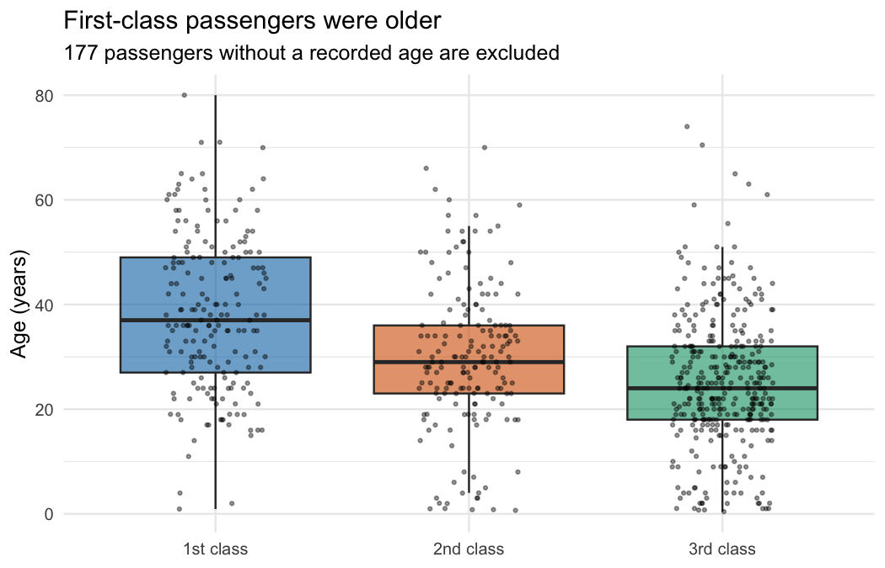<!-- -->

## 7. Interactive plots

Any ggplot can become interactive (zoom, hover tooltips) with
`plotly::ggplotly()`. Interactive plots only work in HTML reports, so
this chunk is shown but not run in this GitHub document.

``` r
library(plotly)

p <- ggplot(iris, aes(Petal.Length, Sepal.Width, color = Species)) +
  geom_point()

ggplotly(p)
```

## Key takeaways

- A plot is built in layers: data, aesthetics, geometries, then scales
  and themes.
- Showing the raw points next to bars or boxplots reveals the spread
  that a single mean hides.
- On the Titanic, sex and class together explain most of who survived:
  74% of women versus 19% of men.
