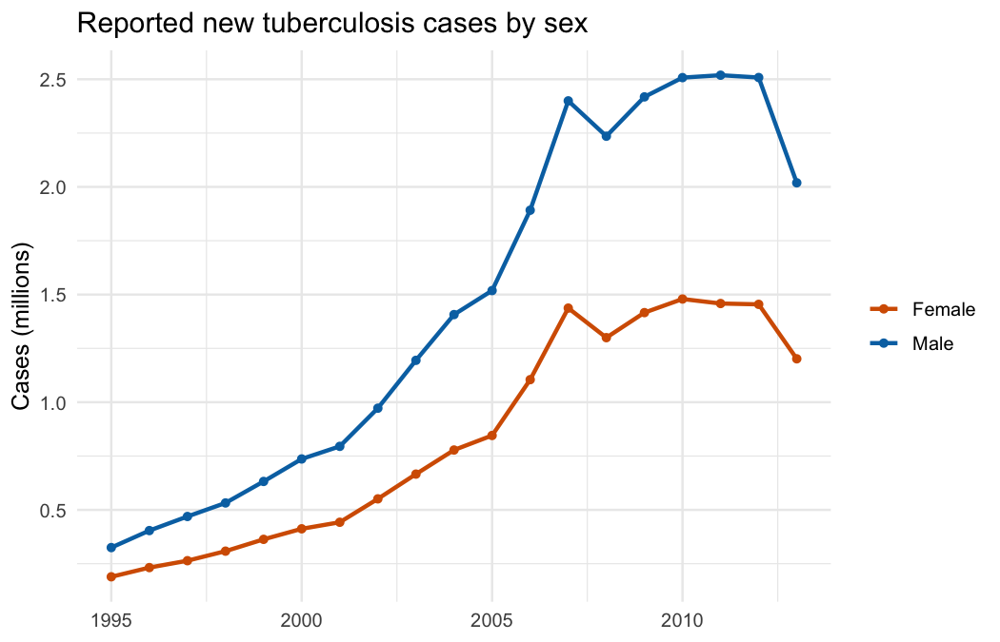
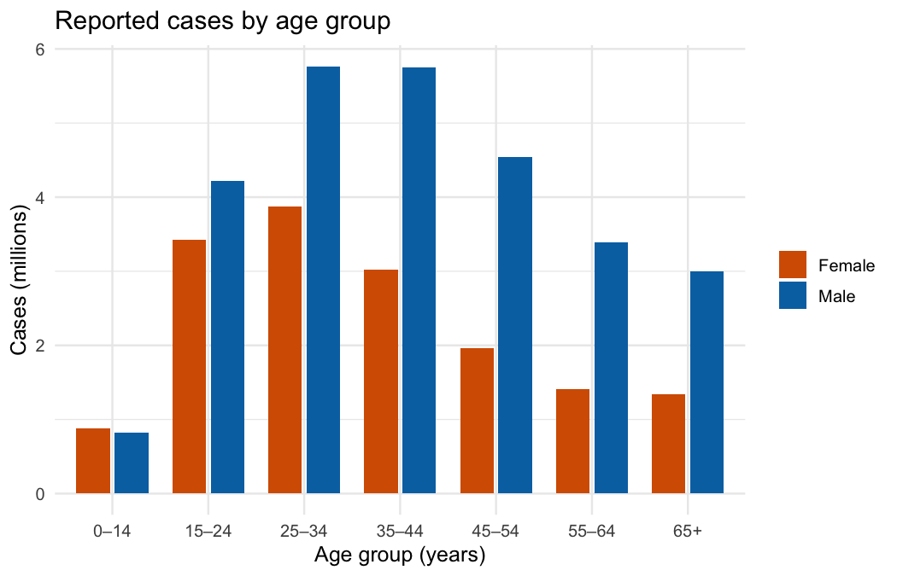
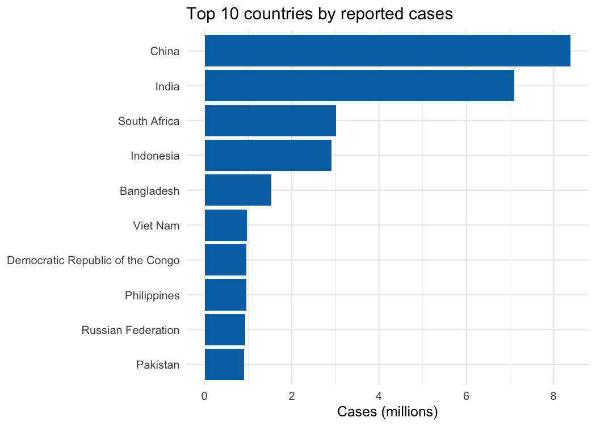

03 · Tidy Data: WHO Tuberculosis Cases
================
Maria Jose Ospina

Real datasets rarely arrive ready to analyze. This report takes the
**World Health Organization (WHO) tuberculosis dataset**, a classic
example of messy data, and reshapes it step by step into a **tidy**
format with `tidyr` and `dplyr`. It then shows why the effort pays off:
once the data is tidy, summaries and plots take only a few lines.

``` r
library(tidyverse)
library(knitr)

theme_set(theme_minimal(base_size = 12))
```

## 1. What is tidy data?

A dataset is **tidy** when:

1.  Each **variable** is a column.
2.  Each **observation** is a row.
3.  Each **value** is a cell.

## 2. The raw data

The data comes from the WHO *Global Tuberculosis Report* and is included
in `tidyr` as `who`. It records tuberculosis cases by country, year,
diagnosis method, sex and age group.

``` r
who
```

    ## # A tibble: 7,240 × 60
    ##    country  iso2  iso3   year new_sp_m014 new_sp_m1524 new_sp_m2534 new_sp_m3544
    ##    <chr>    <chr> <chr> <dbl>       <dbl>        <dbl>        <dbl>        <dbl>
    ##  1 Afghani… AF    AFG    1980          NA           NA           NA           NA
    ##  2 Afghani… AF    AFG    1981          NA           NA           NA           NA
    ##  3 Afghani… AF    AFG    1982          NA           NA           NA           NA
    ##  4 Afghani… AF    AFG    1983          NA           NA           NA           NA
    ##  5 Afghani… AF    AFG    1984          NA           NA           NA           NA
    ##  6 Afghani… AF    AFG    1985          NA           NA           NA           NA
    ##  7 Afghani… AF    AFG    1986          NA           NA           NA           NA
    ##  8 Afghani… AF    AFG    1987          NA           NA           NA           NA
    ##  9 Afghani… AF    AFG    1988          NA           NA           NA           NA
    ## 10 Afghani… AF    AFG    1989          NA           NA           NA           NA
    ## # ℹ 7,230 more rows
    ## # ℹ 52 more variables: new_sp_m4554 <dbl>, new_sp_m5564 <dbl>,
    ## #   new_sp_m65 <dbl>, new_sp_f014 <dbl>, new_sp_f1524 <dbl>,
    ## #   new_sp_f2534 <dbl>, new_sp_f3544 <dbl>, new_sp_f4554 <dbl>,
    ## #   new_sp_f5564 <dbl>, new_sp_f65 <dbl>, new_sn_m014 <dbl>,
    ## #   new_sn_m1524 <dbl>, new_sn_m2534 <dbl>, new_sn_m3544 <dbl>,
    ## #   new_sn_m4554 <dbl>, new_sn_m5564 <dbl>, new_sn_m65 <dbl>, …

``` r
dim(who)
```

    ## [1] 7240   60

The dataset has **60 columns**, but only a few of them are real
variables:

- `country`, `iso2` and `iso3` all identify the country, so two of them
  are redundant.
- `year` is a variable.
- The other 56 columns, from `new_sp_m014` to `newrel_f65`, are **not
  variables**: their names combine several pieces of information
  (diagnosis, sex and age), and their cells hold the number of cases.

## 3. Step by step

### Step 1 · Gather the case columns into rows

All the case columns are stacked into two: `key` (the old column name)
and `cases` (the count). Most cells are empty, so
`values_drop_na = TRUE` removes them.

``` r
who1 <- who |>
  pivot_longer(
    cols = new_sp_m014:newrel_f65,
    names_to = "key",
    values_to = "cases",
    values_drop_na = TRUE
  )

who1
```

    ## # A tibble: 76,046 × 6
    ##    country     iso2  iso3   year key          cases
    ##    <chr>       <chr> <chr> <dbl> <chr>        <dbl>
    ##  1 Afghanistan AF    AFG    1997 new_sp_m014      0
    ##  2 Afghanistan AF    AFG    1997 new_sp_m1524    10
    ##  3 Afghanistan AF    AFG    1997 new_sp_m2534     6
    ##  4 Afghanistan AF    AFG    1997 new_sp_m3544     3
    ##  5 Afghanistan AF    AFG    1997 new_sp_m4554     5
    ##  6 Afghanistan AF    AFG    1997 new_sp_m5564     2
    ##  7 Afghanistan AF    AFG    1997 new_sp_m65       0
    ##  8 Afghanistan AF    AFG    1997 new_sp_f014      5
    ##  9 Afghanistan AF    AFG    1997 new_sp_f1524    38
    ## 10 Afghanistan AF    AFG    1997 new_sp_f2534    36
    ## # ℹ 76,036 more rows

Counting the keys shows the structure of the codes:

``` r
who1 |> count(key)
```

    ## # A tibble: 56 × 2
    ##    key              n
    ##    <chr>        <int>
    ##  1 new_ep_f014   1032
    ##  2 new_ep_f1524  1021
    ##  3 new_ep_f2534  1021
    ##  4 new_ep_f3544  1021
    ##  5 new_ep_f4554  1017
    ##  6 new_ep_f5564  1017
    ##  7 new_ep_f65    1014
    ##  8 new_ep_m014   1038
    ##  9 new_ep_m1524  1026
    ## 10 new_ep_m2534  1020
    ## # ℹ 46 more rows

### Step 2 · Understand the codes

Each key follows the pattern `new_<type>_<sex><age>`:

| Part | Values | Meaning |
|----|----|----|
| Prefix | `new` | New tuberculosis cases (every column in this dataset) |
| Type | `sp` | Pulmonary, smear-positive: detected with a sputum smear test |
|  | `sn` | Pulmonary, smear-negative: not detected with a smear test |
|  | `ep` | Extrapulmonary: outside the lungs |
|  | `rel` | Relapse: a patient who had tuberculosis before |
| Sex | `m` / `f` | Male / female |
| Age group | `014`, `1524`, `2534`, `3544`, `4554`, `5564`, `65` | 0–14, 15–24, 25–34, 35–44, 45–54, 55–64 and 65+ years |

### Step 3 · Fix the inconsistent names

The relapse columns are written `newrel` instead of `new_rel`. If this
is not fixed, the next step splits them incorrectly.

``` r
who2 <- who1 |>
  mutate(key = str_replace(key, "newrel", "new_rel"))

who2 |> filter(str_detect(key, "rel")) |> distinct(key) |> head()
```

    ## # A tibble: 6 × 1
    ##   key          
    ##   <chr>        
    ## 1 new_rel_m014 
    ## 2 new_rel_f014 
    ## 3 new_rel_m1524
    ## 4 new_rel_m2534
    ## 5 new_rel_m3544
    ## 6 new_rel_m4554

### Step 4 · Split the key into its parts

The key is split at each `_` into three columns.

``` r
who3 <- who2 |>
  separate_wider_delim(key, delim = "_", names = c("new", "type", "sexage"))

who3
```

    ## # A tibble: 76,046 × 8
    ##    country     iso2  iso3   year new   type  sexage cases
    ##    <chr>       <chr> <chr> <dbl> <chr> <chr> <chr>  <dbl>
    ##  1 Afghanistan AF    AFG    1997 new   sp    m014       0
    ##  2 Afghanistan AF    AFG    1997 new   sp    m1524     10
    ##  3 Afghanistan AF    AFG    1997 new   sp    m2534      6
    ##  4 Afghanistan AF    AFG    1997 new   sp    m3544      3
    ##  5 Afghanistan AF    AFG    1997 new   sp    m4554      5
    ##  6 Afghanistan AF    AFG    1997 new   sp    m5564      2
    ##  7 Afghanistan AF    AFG    1997 new   sp    m65        0
    ##  8 Afghanistan AF    AFG    1997 new   sp    f014       5
    ##  9 Afghanistan AF    AFG    1997 new   sp    f1524     38
    ## 10 Afghanistan AF    AFG    1997 new   sp    f2534     36
    ## # ℹ 76,036 more rows

### Step 5 · Drop redundant columns

`new` has the same value in every row, and `iso2` and `iso3` repeat
`country`.

``` r
who3 |> count(new)
```

    ## # A tibble: 1 × 2
    ##   new       n
    ##   <chr> <int>
    ## 1 new   76046

``` r
who4 <- who3 |>
  select(-new, -iso2, -iso3)
```

### Step 6 · Separate sex and age

The first character is the sex and the rest is the age group.

``` r
who5 <- who4 |>
  separate_wider_regex(sexage, patterns = c(sex = "[mf]", age = ".*"))

who5
```

    ## # A tibble: 76,046 × 6
    ##    country      year type  sex   age   cases
    ##    <chr>       <dbl> <chr> <chr> <chr> <dbl>
    ##  1 Afghanistan  1997 sp    m     014       0
    ##  2 Afghanistan  1997 sp    m     1524     10
    ##  3 Afghanistan  1997 sp    m     2534      6
    ##  4 Afghanistan  1997 sp    m     3544      3
    ##  5 Afghanistan  1997 sp    m     4554      5
    ##  6 Afghanistan  1997 sp    m     5564      2
    ##  7 Afghanistan  1997 sp    m     65        0
    ##  8 Afghanistan  1997 sp    f     014       5
    ##  9 Afghanistan  1997 sp    f     1524     38
    ## 10 Afghanistan  1997 sp    f     2534     36
    ## # ℹ 76,036 more rows

### Step 7 · Make the values readable

``` r
age_labels <- c("014" = "0–14", "1524" = "15–24", "2534" = "25–34", "3544" = "35–44",
                "4554" = "45–54", "5564" = "55–64", "65" = "65+")

type_labels <- c(sp = "Smear-positive", sn = "Smear-negative",
                 ep = "Extrapulmonary", rel = "Relapse")

who_tidy <- who5 |>
  mutate(
    type = factor(type_labels[type], levels = type_labels),
    sex  = factor(sex, levels = c("f", "m"), labels = c("Female", "Male")),
    age  = factor(age_labels[age], levels = age_labels)
  )

who_tidy
```

    ## # A tibble: 76,046 × 6
    ##    country      year type           sex    age   cases
    ##    <chr>       <dbl> <fct>          <fct>  <fct> <dbl>
    ##  1 Afghanistan  1997 Smear-positive Male   0–14      0
    ##  2 Afghanistan  1997 Smear-positive Male   15–24    10
    ##  3 Afghanistan  1997 Smear-positive Male   25–34     6
    ##  4 Afghanistan  1997 Smear-positive Male   35–44     3
    ##  5 Afghanistan  1997 Smear-positive Male   45–54     5
    ##  6 Afghanistan  1997 Smear-positive Male   55–64     2
    ##  7 Afghanistan  1997 Smear-positive Male   65+       0
    ##  8 Afghanistan  1997 Smear-positive Female 0–14      5
    ##  9 Afghanistan  1997 Smear-positive Female 15–24    38
    ## 10 Afghanistan  1997 Smear-positive Female 25–34    36
    ## # ℹ 76,036 more rows

### All steps in one pipeline

``` r
who_tidy_pipeline <- who |>
  pivot_longer(new_sp_m014:newrel_f65, names_to = "key",
               values_to = "cases", values_drop_na = TRUE) |>
  mutate(key = str_replace(key, "newrel", "new_rel")) |>
  separate_wider_delim(key, delim = "_", names = c("new", "type", "sexage")) |>
  select(-new, -iso2, -iso3) |>
  separate_wider_regex(sexage, patterns = c(sex = "[mf]", age = ".*"))

# Same result as the step-by-step version
nrow(who_tidy_pipeline) == nrow(who5)
```

    ## [1] TRUE

## 4. Before and after

``` r
tibble(
  dataset = c("Raw (who)", "Tidy (who_tidy)"),
  rows    = c(nrow(who), nrow(who_tidy)),
  columns = c(ncol(who), ncol(who_tidy))
) |> kable(format.args = list(big.mark = ","))
```

| dataset         |   rows | columns |
|:----------------|-------:|--------:|
| Raw (who)       |  7,240 |      60 |
| Tidy (who_tidy) | 76,046 |       6 |

From a wide table with 60 columns to a long table with 6 columns, one
row per country, year, type, sex and age group.

## 5. Why it pays off: exploring the tidy data

> **Note:** reporting practices changed over time (for example, relapse
> cases only appear in the most recent years), so totals across years
> reflect **reported** cases, not true incidence.

### Reported cases over time

``` r
who_tidy |>
  filter(year >= 1995) |>
  group_by(year, sex) |>
  summarise(cases = sum(cases), .groups = "drop") |>
  ggplot(aes(year, cases / 1e6, color = sex)) +
  geom_line(linewidth = 1) +
  geom_point(size = 1.5) +
  scale_color_manual(values = c(Female = "#D55E00", Male = "#0072B2")) +
  labs(title = "Reported new tuberculosis cases by sex",
       x = NULL, y = "Cases (millions)", color = NULL)
```

<!-- -->

``` r
male_share <- who_tidy |>
  group_by(sex) |>
  summarise(cases = sum(cases)) |>
  mutate(share = cases / sum(cases)) |>
  filter(sex == "Male") |>
  pull(share)
```

Men account for **63%** of all reported cases in the dataset.

### Cases by age group and sex

``` r
who_tidy |>
  group_by(age, sex) |>
  summarise(cases = sum(cases), .groups = "drop") |>
  ggplot(aes(age, cases / 1e6, fill = sex)) +
  geom_col(position = position_dodge(width = 0.8), width = 0.7) +
  scale_fill_manual(values = c(Female = "#D55E00", Male = "#0072B2")) +
  labs(title = "Reported cases by age group",
       x = "Age group (years)", y = "Cases (millions)", fill = NULL)
```

<!-- -->

### Countries with the most reported cases

``` r
top_countries <- who_tidy |>
  group_by(country) |>
  summarise(cases = sum(cases)) |>
  slice_max(cases, n = 10)

top_countries |>
  ggplot(aes(cases / 1e6, fct_reorder(country, cases))) +
  geom_col(fill = "#0072B2") +
  labs(title = "Top 10 countries by reported cases",
       x = "Cases (millions)", y = NULL)
```

<!-- -->

``` r
top_share <- sum(top_countries$cases) / sum(who_tidy$cases)
```

The 10 countries with the most reported cases account for **64%** of all
cases in the dataset.

## Key takeaways

- Column names can hide several variables at once; `pivot_longer()` and
  the `separate_wider_*()` functions turn them back into proper columns.
- Small inconsistencies (`newrel` vs. `new_rel`) must be fixed
  **before** splitting, or the result is silently wrong.
- Once the data is tidy, every summary above is just `group_by()` +
  `summarise()` + `ggplot()`.
