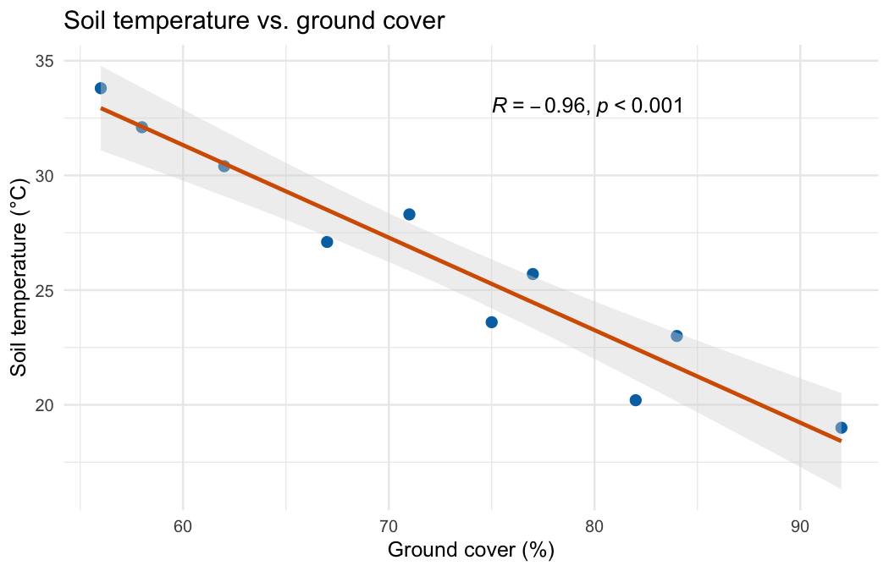
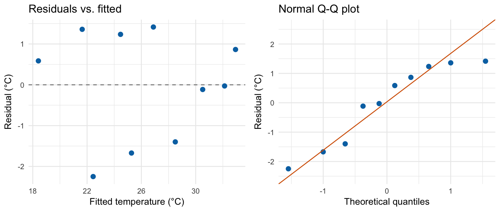
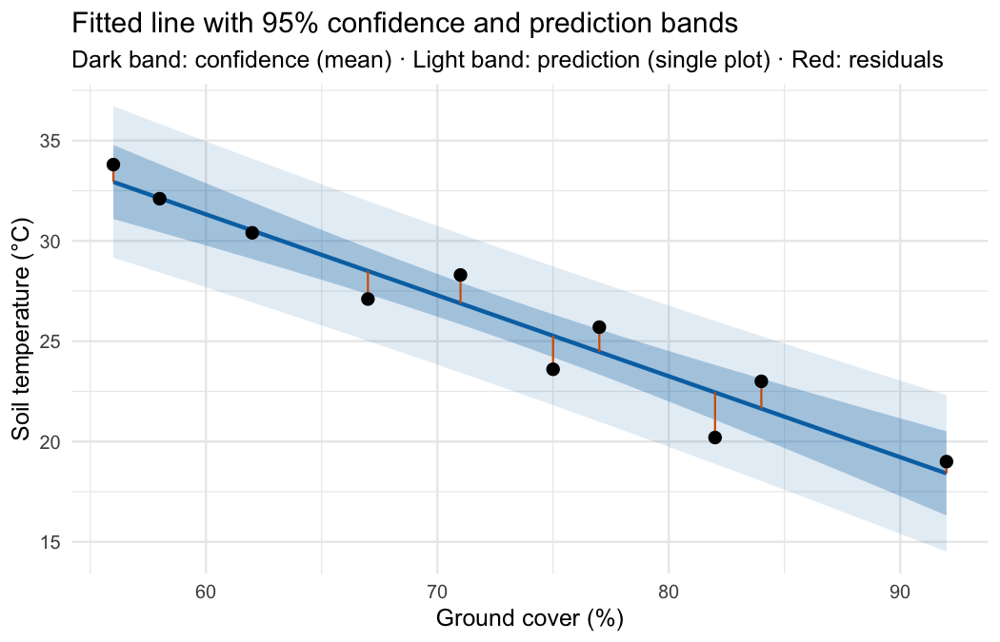

04 · Simple Linear Regression: Soil Temperature and Ground Cover
================
Maria Jose Ospina

Does more vegetation cover keep the soil cooler, and by how much? This
report measures the relationship between **ground cover** and **soil
temperature**, fits a simple linear regression, checks its assumptions
and uses it to make predictions with uncertainty.

``` r
library(tidyverse)
library(ggpubr)   # scatter plot with correlation
library(knitr)

theme_set(theme_minimal(base_size = 12))
```

## 1. Data

Ten plots, each with its percentage of ground cover and its soil
temperature.

``` r
soil <- read_delim("data/soil_temperature.csv", delim = ";", trim_ws = TRUE) |>
  rename(cover = Cobertura, temperature = Temperatura)

kable(soil, col.names = c("Ground cover (%)", "Soil temperature (°C)"))
```

| Ground cover (%) | Soil temperature (°C) |
|-----------------:|----------------------:|
|               56 |                  33.8 |
|               58 |                  32.1 |
|               62 |                  30.4 |
|               67 |                  27.1 |
|               71 |                  28.3 |
|               75 |                  23.6 |
|               77 |                  25.7 |
|               82 |                  20.2 |
|               84 |                  23.0 |
|               92 |                  19.0 |

## 2. Correlation

``` r
r <- cor(soil$cover, soil$temperature)
cor_test <- cor.test(soil$cover, soil$temperature)
cor_test
```

    ## 
    ##  Pearson's product-moment correlation
    ## 
    ## data:  soil$cover and soil$temperature
    ## t = -10.014, df = 8, p-value = 8.4e-06
    ## alternative hypothesis: true correlation is not equal to 0
    ## 95 percent confidence interval:
    ##  -0.9913168 -0.8443079
    ## sample estimates:
    ##        cor 
    ## -0.9623503

The Pearson correlation is **r = -0.96**: a strong negative
relationship. Plots with more cover have cooler soil.

``` r
ggscatter(soil, x = "cover", y = "temperature",
          add = "reg.line", conf.int = TRUE,
          color = "#0072B2", size = 2.5,
          add.params = list(color = "#D55E00", fill = "grey85")) +
  stat_cor(method = "pearson", label.x = 75, label.y = 33, r.accuracy = 0.01, p.accuracy = 0.001) +
  theme_minimal(base_size = 12) +
  labs(title = "Soil temperature vs. ground cover",
       x = "Ground cover (%)", y = "Soil temperature (°C)")
```

<!-- -->

## 3. The model

$$\text{temperature} = \beta_0 + \beta_1 \cdot \text{cover} + \varepsilon$$

``` r
model <- lm(temperature ~ cover, data = soil)
summary(model)
```

    ## 
    ## Call:
    ## lm(formula = temperature ~ cover, data = soil)
    ## 
    ## Residuals:
    ##     Min      1Q  Median      3Q     Max 
    ## -2.2477 -1.0774  0.2787  1.1428  1.4153 
    ## 
    ## Coefficients:
    ##             Estimate Std. Error t value Pr(>|t|)    
    ## (Intercept) 55.52357    2.95095   18.82 6.58e-08 ***
    ## cover       -0.40336    0.04028  -10.01 8.40e-06 ***
    ## ---
    ## Signif. codes:  0 '***' 0.001 '**' 0.01 '*' 0.05 '.' 0.1 ' ' 1
    ## 
    ## Residual standard error: 1.427 on 8 degrees of freedom
    ## Multiple R-squared:  0.9261, Adjusted R-squared:  0.9169 
    ## F-statistic: 100.3 on 1 and 8 DF,  p-value: 8.4e-06

``` r
anova(model)
```

    ## Analysis of Variance Table
    ## 
    ## Response: temperature
    ##           Df  Sum Sq Mean Sq F value  Pr(>F)    
    ## cover      1 204.094 204.094  100.28 8.4e-06 ***
    ## Residuals  8  16.282   2.035                    
    ## ---
    ## Signif. codes:  0 '***' 0.001 '**' 0.01 '*' 0.05 '.' 0.1 ' ' 1

``` r
b0 <- coef(model)[["(Intercept)"]]
b1 <- coef(model)[["cover"]]
r2 <- summary(model)$r.squared
p_value <- summary(model)$coefficients["cover", "Pr(>|t|)"]
ci_b1 <- confint(model)["cover", ]
```

| Term | Estimate | Meaning |
|----|----|----|
| Intercept (β₀) | 55.52 °C | Expected temperature at 0% cover. It is outside the observed range (56–92%), so it should not be interpreted literally. |
| Slope (β₁) | -0.403 °C per % | Each additional percentage point of cover lowers the soil temperature by about 0.4 °C. |
| R² | 0.926 | Ground cover explains 93% of the variation in soil temperature. |

The slope is significant (p \< 0.001), and its 95% confidence interval
goes from -0.5 to -0.31 °C per percentage point: it does not include
zero.

So **10 more percentage points of cover mean about 4 °C cooler soil**.

## 4. Checking the assumptions

A linear model is only reliable if its residuals (observed − fitted)
behave well: no pattern against the fitted values, roughly normal, and
with constant spread.

``` r
soil_fit <- soil |>
  mutate(fitted = fitted(model), residual = residuals(model))

kable(soil_fit, digits = 2,
      col.names = c("Cover (%)", "Temperature (°C)", "Fitted (°C)", "Residual (°C)"))
```

| Cover (%) | Temperature (°C) | Fitted (°C) | Residual (°C) |
|----------:|-----------------:|------------:|--------------:|
|        56 |             33.8 |       32.94 |          0.86 |
|        58 |             32.1 |       32.13 |         -0.03 |
|        62 |             30.4 |       30.51 |         -0.11 |
|        67 |             27.1 |       28.50 |         -1.40 |
|        71 |             28.3 |       26.88 |          1.42 |
|        75 |             23.6 |       25.27 |         -1.67 |
|        77 |             25.7 |       24.46 |          1.24 |
|        82 |             20.2 |       22.45 |         -2.25 |
|        84 |             23.0 |       21.64 |          1.36 |
|        92 |             19.0 |       18.41 |          0.59 |

``` r
p1 <- ggplot(soil_fit, aes(fitted, residual)) +
  geom_hline(yintercept = 0, linetype = "dashed", color = "grey50") +
  geom_point(size = 2.5, color = "#0072B2") +
  labs(title = "Residuals vs. fitted", x = "Fitted temperature (°C)", y = "Residual (°C)")

p2 <- ggplot(soil_fit, aes(sample = residual)) +
  stat_qq(size = 2.5, color = "#0072B2") +
  stat_qq_line(color = "#D55E00") +
  labs(title = "Normal Q-Q plot", x = "Theoretical quantiles", y = "Residual (°C)")

ggarrange(p1, p2, ncol = 2)
```

<!-- -->

``` r
shapiro <- shapiro.test(residuals(model))
shapiro
```

    ## 
    ##  Shapiro-Wilk normality test
    ## 
    ## data:  residuals(model)
    ## W = 0.89055, p-value = 0.172

The residuals show no clear pattern and the Shapiro-Wilk test does not
reject normality (p = 0.17). With only 10 plots, these checks have
little power, so the conclusions should be confirmed with more data.

## 5. Predictions with uncertainty

Two kinds of intervals:

- **Confidence interval:** where the **average** temperature of plots
  with that cover is expected to be.
- **Prediction interval:** where the temperature of **one new plot** is
  expected to be. It is always wider.

``` r
grid <- tibble(cover = seq(min(soil$cover), max(soil$cover), length.out = 100))

bands <- grid |>
  bind_cols(
    as_tibble(predict(model, grid, interval = "confidence", level = 0.95)) |>
      rename(fit = fit, conf_low = lwr, conf_high = upr),
    as_tibble(predict(model, grid, interval = "prediction", level = 0.95)) |>
      select(pred_low = lwr, pred_high = upr)
  )

ggplot(bands, aes(cover)) +
  geom_ribbon(aes(ymin = pred_low, ymax = pred_high), fill = "#0072B2", alpha = 0.12) +
  geom_ribbon(aes(ymin = conf_low, ymax = conf_high), fill = "#0072B2", alpha = 0.3) +
  geom_line(aes(y = fit), color = "#0072B2", linewidth = 1) +
  geom_segment(data = soil_fit, aes(x = cover, xend = cover, y = temperature, yend = fitted),
               color = "#D55E00", linewidth = 0.5) +
  geom_point(data = soil_fit, aes(y = temperature), size = 2.5) +
  labs(title = "Fitted line with 95% confidence and prediction bands",
       subtitle = "Dark band: confidence (mean) · Light band: prediction (single plot) · Red: residuals",
       x = "Ground cover (%)", y = "Soil temperature (°C)")
```

<!-- -->

### Prediction at 80% cover

``` r
new_plot <- tibble(cover = 80)

pred_80 <- predict(model, new_plot, interval = "prediction", level = 0.95)
conf_80 <- predict(model, new_plot, interval = "confidence", level = 0.95)

tibble(
  interval = c("Confidence (mean of plots)", "Prediction (one plot)"),
  estimate = c(conf_80[, "fit"], pred_80[, "fit"]),
  lower    = c(conf_80[, "lwr"], pred_80[, "lwr"]),
  upper    = c(conf_80[, "upr"], pred_80[, "upr"])
) |> kable(digits = 2)
```

| interval                   | estimate | lower | upper |
|:---------------------------|---------:|------:|------:|
| Confidence (mean of plots) |    23.25 | 22.00 | 24.51 |
| Prediction (one plot)      |    23.25 | 19.73 | 26.78 |

A plot with **80% ground cover** is expected to have a soil temperature
of about **23.3 °C**. A single new plot could reasonably fall between
19.7 and 26.8 °C.

## Key takeaways

- Ground cover and soil temperature are strongly and negatively related
  (r = -0.96, R² = 0.93).
- Each extra percentage point of cover lowers soil temperature by about
  0.4 °C within the observed range (56–92%).
- Predictions should always come with an interval, and the model should
  not be used outside the range of the data.
- With only 10 plots, the results are a good first estimate but need
  more data to be confirmed.
