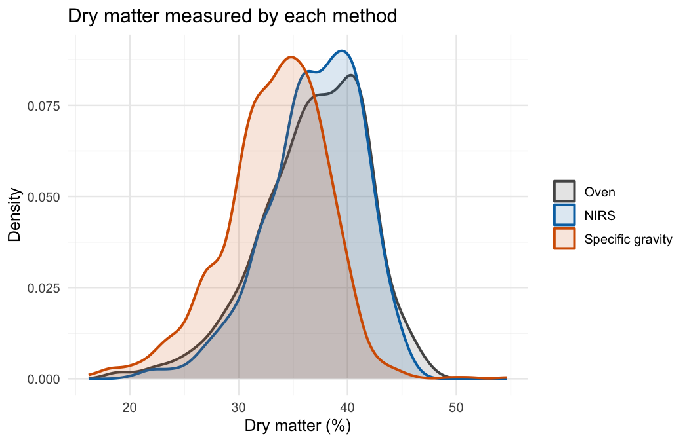
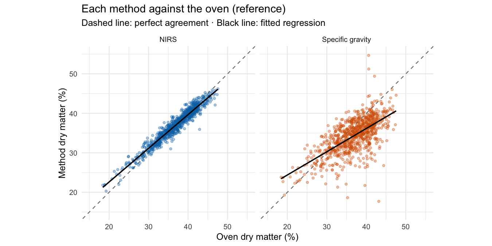
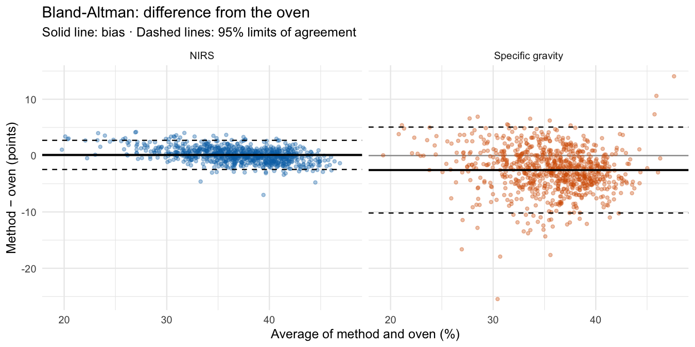
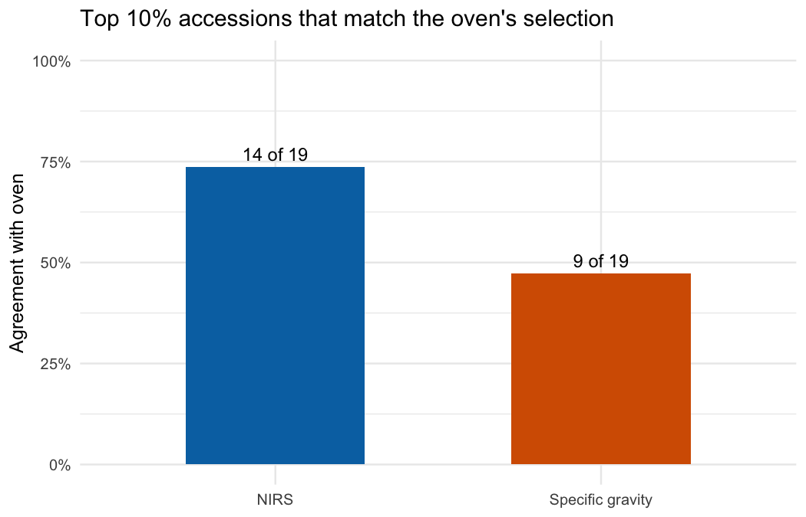

05 · Case Study: Can a NIRS Scanner Replace the Oven to Measure Cassava
Dry Matter?
================
Maria Jose Ospina

## The question

**Dry matter content** is one of the most important traits in cassava
breeding: roots with more dry matter give more starch and are worth more
to farmers and processors. Breeding programs measure it on thousands of
plots every season, so the method matters.

| Method | Variable | How it works | Trade-off |
|----|----|----|----|
| **Oven drying** | `DM_raw` | Weigh a root sample, dry it in an oven and weigh it again | Reference method, but slow |
| **Specific gravity** | `DM_gravity` | Weigh the roots in air and in water | Fast and cheap, but indirect |
| **NIRS** | `DM_nirs` | Scan the sample with near-infrared spectroscopy | Very fast, but needs calibration |

**Can the faster methods replace the oven?** This report compares them
with correlation, regression and agreement analysis, and checks whether
they would lead a breeder to select the same varieties.

``` r
library(tidyverse)
library(knitr)

theme_set(theme_minimal(base_size = 12))

method_colors <- c("Oven" = "#555555", "NIRS" = "#0072B2", "Specific gravity" = "#D55E00")
```

## 1. Data

``` r
cassava <- read_csv("data/cassava_dry_matter.csv") |>
  mutate(
    trial     = str_extract(plot_name, "^[^_]+_[^_]+"),
    location  = str_split_i(plot_name, "_", 2),
    replicate = str_extract(plot_name, "rep\\d")
  )

glimpse(cassava)
```

    ## Rows: 1,286
    ## Columns: 8
    ## $ plot_name      <chr> "202109DVGN6_momi_rep1_ARG55_83", "202109DVGN6_momi_rep…
    ## $ accession_name <chr> "ARG55", "ARG65", "ARG67", "BOL1", "BRA1001", "BRA1081"…
    ## $ DM_raw         <dbl> 39.41, 37.92, 35.26, 30.72, 37.28, 32.30, 38.99, 34.82,…
    ## $ DM_gravity     <dbl> 35.6, 34.3, 34.2, 30.1, 34.1, 32.4, 38.2, 31.6, 28.9, 3…
    ## $ DM_nirs        <dbl> 38.9, 38.8, 34.1, 30.8, 36.3, 33.6, 38.0, 35.1, 31.0, 3…
    ## $ trial          <chr> "202109DVGN6_momi", "202109DVGN6_momi", "202109DVGN6_mo…
    ## $ location       <chr> "momi", "momi", "momi", "momi", "momi", "momi", "momi",…
    ## $ replicate      <chr> "rep1", "rep1", "rep1", "rep1", "rep1", "rep1", "rep1",…

The dataset has **1286 field plots** of **189 cassava accessions**,
grown in **4 trials** at two locations, with two replicates each.

``` r
cassava |>
  group_by(trial) |>
  summarise(
    plots      = n(),
    oven       = sum(!is.na(DM_raw)),
    nirs       = sum(!is.na(DM_nirs)),
    gravity    = sum(!is.na(DM_gravity))
  ) |>
  kable(col.names = c("Trial", "Plots", "Oven", "NIRS", "Specific gravity"))
```

| Trial            | Plots | Oven | NIRS | Specific gravity |
|:-----------------|------:|-----:|-----:|-----------------:|
| 202101DVGN6_ciat |   272 |  253 |  253 |              269 |
| 202109DVGN6_momi |   272 |  268 |  269 |              270 |
| 202206DVGN6_ciat |   374 |  329 |  329 |              355 |
| 202232DVGN6_momi |   368 |    0 |    0 |              365 |

One trial was measured **only with specific gravity**, so every
comparison against the oven uses the plots where both methods are
available.

``` r
nirs_pairs    <- cassava |> drop_na(DM_raw, DM_nirs)
gravity_pairs <- cassava |> drop_na(DM_raw, DM_gravity)
```

- Oven vs. NIRS: **850 plots**
- Oven vs. specific gravity: **846 plots**

### Distribution of each method

``` r
cassava |>
  pivot_longer(c(DM_raw, DM_nirs, DM_gravity), names_to = "method", values_to = "dm") |>
  filter(!is.na(dm)) |>
  mutate(method = recode(method, DM_raw = "Oven", DM_nirs = "NIRS", DM_gravity = "Specific gravity"),
         method = factor(method, levels = names(method_colors))) |>
  ggplot(aes(dm, color = method, fill = method)) +
  geom_density(alpha = 0.15, linewidth = 0.9) +
  scale_color_manual(values = method_colors) +
  scale_fill_manual(values = method_colors) +
  labs(title = "Dry matter measured by each method",
       x = "Dry matter (%)", y = "Density", color = NULL, fill = NULL)
```

<!-- -->

The oven and NIRS curves almost overlap, while specific gravity is
shifted to lower values.

## 2. Correlation

``` r
cor_matrix <- cassava |>
  select(Oven = DM_raw, NIRS = DM_nirs, `Specific gravity` = DM_gravity) |>
  cor(use = "pairwise.complete.obs")

round(cor_matrix, 3)
```

    ##                   Oven  NIRS Specific gravity
    ## Oven             1.000 0.967            0.657
    ## NIRS             0.967 1.000            0.656
    ## Specific gravity 0.657 0.656            1.000

``` r
bind_rows(
  nirs_pairs    |> transmute(oven = DM_raw, value = DM_nirs,    method = "NIRS"),
  gravity_pairs |> transmute(oven = DM_raw, value = DM_gravity, method = "Specific gravity")
) |>
  ggplot(aes(oven, value, color = method)) +
  geom_abline(slope = 1, intercept = 0, linetype = "dashed", color = "grey50") +
  geom_point(alpha = 0.35, size = 1.2, show.legend = FALSE) +
  geom_smooth(method = "lm", se = FALSE, color = "black", linewidth = 0.8) +
  facet_wrap(~ method) +
  scale_color_manual(values = method_colors) +
  coord_equal(xlim = c(15, 55), ylim = c(15, 55)) +
  labs(title = "Each method against the oven (reference)",
       subtitle = "Dashed line: perfect agreement · Black line: fitted regression",
       x = "Oven dry matter (%)", y = "Method dry matter (%)")
```

<!-- -->

NIRS points follow the line of perfect agreement closely; specific
gravity points are much more scattered.

## 3. Regression models

``` r
model_nirs    <- lm(DM_nirs ~ DM_raw, data = nirs_pairs)
model_gravity <- lm(DM_gravity ~ DM_raw, data = gravity_pairs)

summary(model_nirs)
```

    ## 
    ## Call:
    ## lm(formula = DM_nirs ~ DM_raw, data = nirs_pairs)
    ## 
    ## Residuals:
    ##     Min      1Q  Median      3Q     Max 
    ## -6.2199 -0.7060  0.0292  0.7035  3.2037 
    ## 
    ## Coefficients:
    ##             Estimate Std. Error t value Pr(>|t|)    
    ## (Intercept) 5.538484   0.287887   19.24   <2e-16 ***
    ## DM_raw      0.853164   0.007735  110.29   <2e-16 ***
    ## ---
    ## Signif. codes:  0 '***' 0.001 '**' 0.01 '*' 0.05 '.' 0.1 ' ' 1
    ## 
    ## Residual standard error: 1.107 on 848 degrees of freedom
    ## Multiple R-squared:  0.9348, Adjusted R-squared:  0.9348 
    ## F-statistic: 1.216e+04 on 1 and 848 DF,  p-value: < 2.2e-16

``` r
summary(model_gravity)
```

    ## 
    ## Call:
    ## lm(formula = DM_gravity ~ DM_raw, data = gravity_pairs)
    ## 
    ## Residuals:
    ##      Min       1Q   Median       3Q      Max 
    ## -20.3221  -1.6741   0.2114   1.9882  18.1538 
    ## 
    ## Coefficients:
    ##             Estimate Std. Error t value Pr(>|t|)    
    ## (Intercept) 12.59566    0.86654   14.54   <2e-16 ***
    ## DM_raw       0.58912    0.02328   25.31   <2e-16 ***
    ## ---
    ## Signif. codes:  0 '***' 0.001 '**' 0.01 '*' 0.05 '.' 0.1 ' ' 1
    ## 
    ## Residual standard error: 3.327 on 844 degrees of freedom
    ## Multiple R-squared:  0.4315, Adjusted R-squared:  0.4308 
    ## F-statistic: 640.6 on 1 and 844 DF,  p-value: < 2.2e-16

``` r
model_summary <- function(model, name) {
  s <- summary(model)
  tibble(
    method    = name,
    intercept = coef(model)[1],
    slope     = coef(model)[2],
    r_squared = s$r.squared,
    rmse      = sqrt(mean(residuals(model)^2))
  )
}

models <- bind_rows(
  model_summary(model_nirs, "NIRS"),
  model_summary(model_gravity, "Specific gravity")
)

kable(models, digits = 3,
      col.names = c("Method", "Intercept (β₀)", "Slope (β₁)", "R²", "RMSE (points)"))
```

| Method           | Intercept (β₀) | Slope (β₁) |    R² | RMSE (points) |
|:-----------------|---------------:|-----------:|------:|--------------:|
| NIRS             |          5.538 |      0.853 | 0.935 |         1.106 |
| Specific gravity |         12.596 |      0.589 | 0.431 |         3.323 |

``` r
r2_nirs    <- models$r_squared[models$method == "NIRS"]
r2_gravity <- models$r_squared[models$method == "Specific gravity"]
```

- **NIRS** explains **93%** of the variation in oven dry matter, with a
  slope close to 1.
- **Specific gravity** explains only **43%**.

### Prediction: oven dry matter of 30%

The class assignment asked what NIRS value corresponds to a sample with
**30% dry matter in the oven**.

``` r
pred_30 <- predict(model_nirs, tibble(DM_raw = 30), interval = "prediction", level = 0.95)
pred_30
```

    ##        fit     lwr      upr
    ## 1 31.13339 28.9571 33.30968

A sample with 30% dry matter in the oven is expected to read about
**31.1%** on the NIRS, and a single sample would usually fall between
29% and 33.3%.

In practice the question is usually the reverse: the NIRS gives a
reading and the breeder wants the oven-equivalent value. That
calibration model is fitted the other way around:

``` r
calibration <- lm(DM_raw ~ DM_nirs, data = nirs_pairs)
oven_from_30 <- predict(calibration, tibble(DM_nirs = 30), interval = "prediction", level = 0.95)
oven_from_30
```

    ##        fit      lwr     upr
    ## 1 29.20723 26.73997 31.6745

A NIRS reading of 30% corresponds to an oven value of about **29.2%**
(95% prediction interval: 26.7–31.7%).

## 4. Agreement: Bland-Altman analysis

A high correlation does not mean two methods give the **same values**:
one could be consistently higher. The Bland-Altman plot shows the
**difference** between each method and the oven against their
**average**.

- **Bias:** the mean difference (does the method over- or
  underestimate?).
- **Limits of agreement:** bias ± 1.96 × SD of the differences, the
  range where 95% of differences fall.

``` r
agreement <- bind_rows(
  nirs_pairs    |> transmute(method = "NIRS", mean = (DM_raw + DM_nirs) / 2, diff = DM_nirs - DM_raw),
  gravity_pairs |> transmute(method = "Specific gravity", mean = (DM_raw + DM_gravity) / 2, diff = DM_gravity - DM_raw)
)

limits <- agreement |>
  group_by(method) |>
  summarise(
    bias  = mean(diff),
    lower = bias - 1.96 * sd(diff),
    upper = bias + 1.96 * sd(diff),
    .groups = "drop"
  )

kable(limits, digits = 2,
      col.names = c("Method", "Bias (points)", "Lower limit", "Upper limit"))
```

| Method           | Bias (points) | Lower limit | Upper limit |
|:-----------------|--------------:|------------:|------------:|
| NIRS             |          0.12 |       -2.47 |        2.71 |
| Specific gravity |         -2.57 |      -10.19 |        5.06 |

``` r
ggplot(agreement, aes(mean, diff, color = method)) +
  geom_hline(yintercept = 0, color = "grey60") +
  geom_point(alpha = 0.35, size = 1.2, show.legend = FALSE) +
  geom_hline(data = limits, aes(yintercept = bias), linewidth = 0.9, color = "black") +
  geom_hline(data = limits, aes(yintercept = lower), linetype = "dashed", color = "black") +
  geom_hline(data = limits, aes(yintercept = upper), linetype = "dashed", color = "black") +
  facet_wrap(~ method) +
  scale_color_manual(values = method_colors) +
  labs(title = "Bland-Altman: difference from the oven",
       subtitle = "Solid line: bias · Dashed lines: 95% limits of agreement",
       x = "Average of method and oven (%)", y = "Method − oven (points)")
```

<!-- -->

``` r
lim_n <- limits |> filter(method == "NIRS")
lim_g <- limits |> filter(method == "Specific gravity")
```

- **NIRS** has almost no bias (+0.12 points), and 95% of its readings
  fall within -2.5 to +2.7 points of the oven.
- **Specific gravity** underestimates by **2.6 points** on average, and
  its limits are much wider (-10.2 to +5.1 points).

### Is the result consistent across trials?

``` r
cassava |>
  drop_na(DM_raw) |>
  group_by(trial) |>
  summarise(
    plots           = n(),
    r_nirs          = cor(DM_raw, DM_nirs, use = "complete.obs"),
    r_gravity       = cor(DM_raw, DM_gravity, use = "complete.obs"),
    bias_nirs       = mean(DM_nirs - DM_raw, na.rm = TRUE),
    bias_gravity    = mean(DM_gravity - DM_raw, na.rm = TRUE)
  ) |>
  kable(digits = 2,
        col.names = c("Trial", "Plots", "r NIRS", "r gravity", "Bias NIRS", "Bias gravity"))
```

| Trial            | Plots | r NIRS | r gravity | Bias NIRS | Bias gravity |
|:-----------------|------:|-------:|----------:|----------:|-------------:|
| 202101DVGN6_ciat |   253 |   0.97 |      0.56 |      0.28 |        -0.69 |
| 202109DVGN6_momi |   268 |   0.97 |      0.81 |     -0.04 |        -2.82 |
| 202206DVGN6_ciat |   329 |   0.95 |      0.56 |      0.14 |        -3.82 |

NIRS behaves the same way in every trial, while the performance of
specific gravity changes from one trial to another.

## 5. Would the breeder select the same varieties?

In breeding, what matters is often the **ranking**: which accessions
have the highest dry matter and move on to the next stage. Here the
accessions are averaged across plots and the **top 10%** chosen by each
method is compared with the top 10% chosen by the oven.

``` r
accessions <- cassava |>
  drop_na(DM_raw) |>
  group_by(accession_name) |>
  summarise(across(c(DM_raw, DM_nirs, DM_gravity), ~ mean(.x, na.rm = TRUE)), .groups = "drop") |>
  drop_na()

k <- round(nrow(accessions) * 0.10)

top_oven    <- accessions |> slice_max(DM_raw, n = k, with_ties = FALSE) |> pull(accession_name)
top_nirs    <- accessions |> slice_max(DM_nirs, n = k, with_ties = FALSE) |> pull(accession_name)
top_gravity <- accessions |> slice_max(DM_gravity, n = k, with_ties = FALSE) |> pull(accession_name)

selection <- tibble(
  method        = c("NIRS", "Specific gravity"),
  selected      = k,
  same_as_oven  = c(length(intersect(top_nirs, top_oven)), length(intersect(top_gravity, top_oven))),
  spearman_rank = c(cor(accessions$DM_raw, accessions$DM_nirs, method = "spearman"),
                    cor(accessions$DM_raw, accessions$DM_gravity, method = "spearman"))
) |>
  mutate(agreement = same_as_oven / selected)

kable(selection, digits = 2,
      col.names = c("Method", "Accessions selected", "Same as oven", "Rank correlation (Spearman)", "Agreement"))
```

| Method | Accessions selected | Same as oven | Rank correlation (Spearman) | Agreement |
|:---|---:|---:|---:|---:|
| NIRS | 19 | 14 | 0.98 | 0.74 |
| Specific gravity | 19 | 9 | 0.76 | 0.47 |

``` r
selection |>
  ggplot(aes(method, agreement, fill = method)) +
  geom_col(width = 0.55, show.legend = FALSE) +
  geom_text(aes(label = paste0(same_as_oven, " of ", selected)), vjust = -0.5, size = 4) +
  scale_fill_manual(values = method_colors) +
  scale_y_continuous(labels = scales::percent, limits = c(0, 1)) +
  labs(title = "Top 10% accessions that match the oven's selection",
       x = NULL, y = "Agreement with oven")
```

<!-- -->

Choosing the best 19 of 188 accessions with **NIRS** would keep **14**
of the oven’s picks; with **specific gravity**, only **9**.

## Conclusions

- **NIRS can replace the oven for routine screening.** It explains 93%
  of the oven’s variation, has practically no bias, and would select
  most of the same top accessions.
- **Specific gravity is not a good substitute** for precise
  measurements: it underestimates dry matter by about 2.6 points and
  disagrees much more, although it can still help to discard clearly
  poor roots quickly.
- **Recommended practice:** use NIRS for large numbers of plots and keep
  oven drying on a subset of samples each season to check and
  recalibrate the NIRS.

### Limitations

- The comparison only uses plots where both methods were measured; one
  trial had no oven or NIRS data.
- The NIRS calibration is specific to these trials; a new environment or
  new germplasm could need recalibration.
